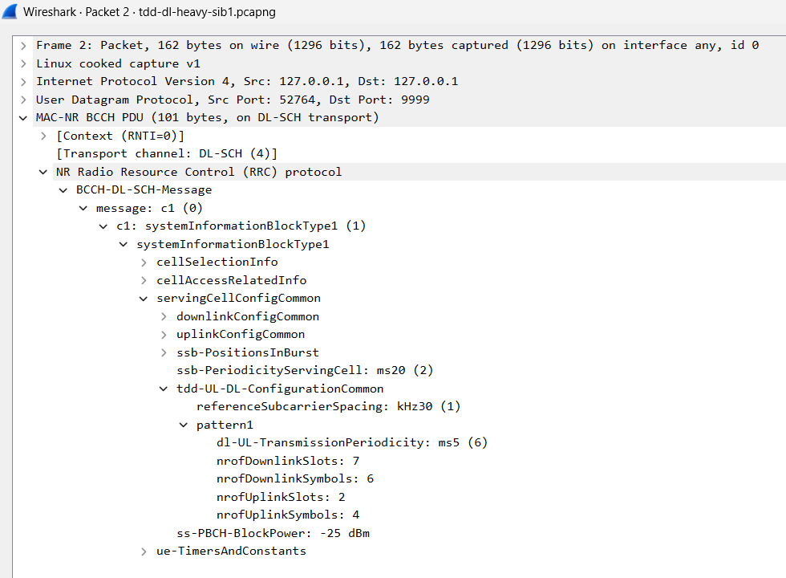
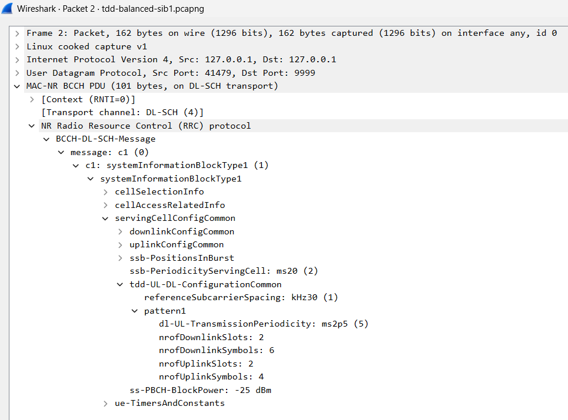
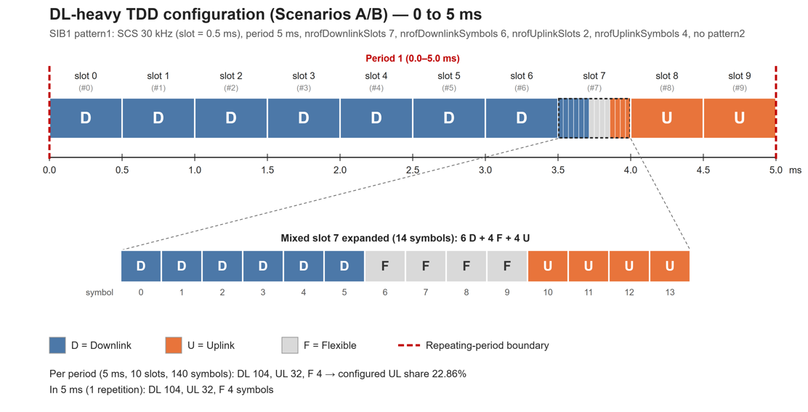
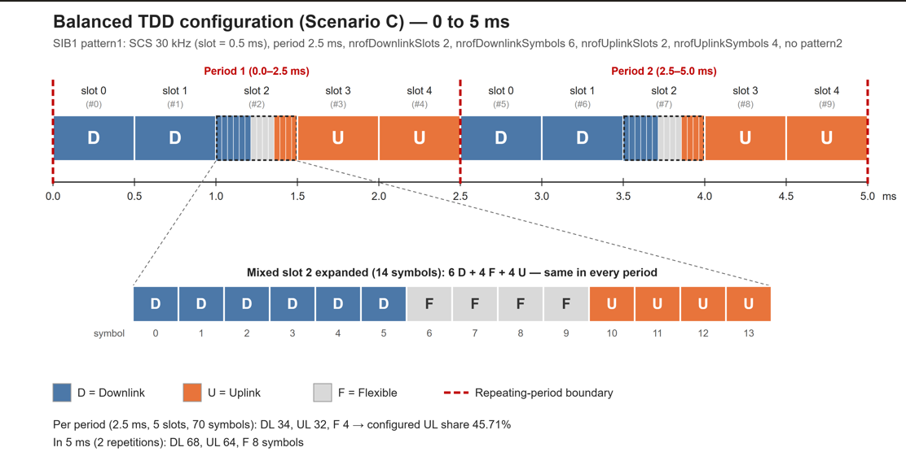
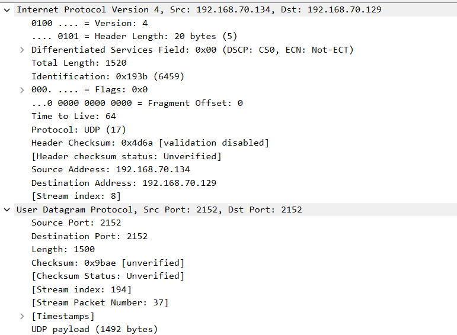
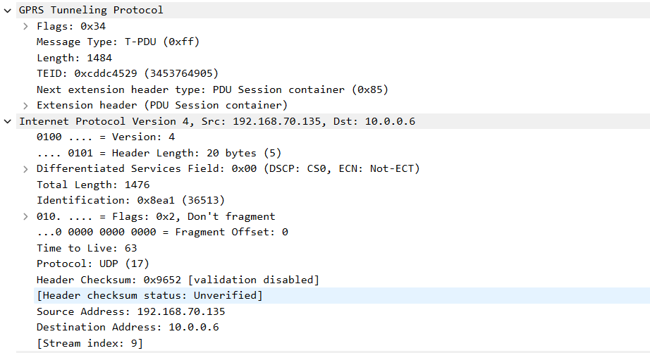
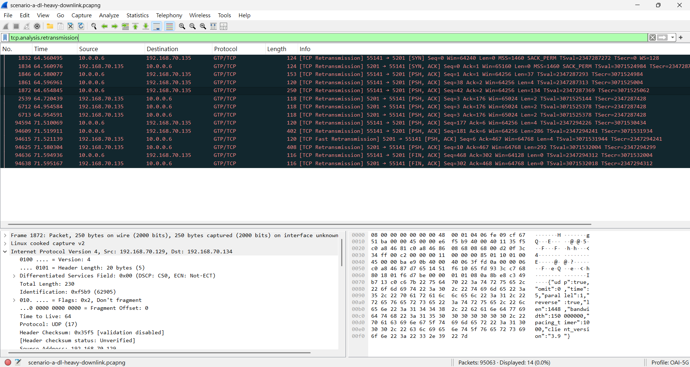
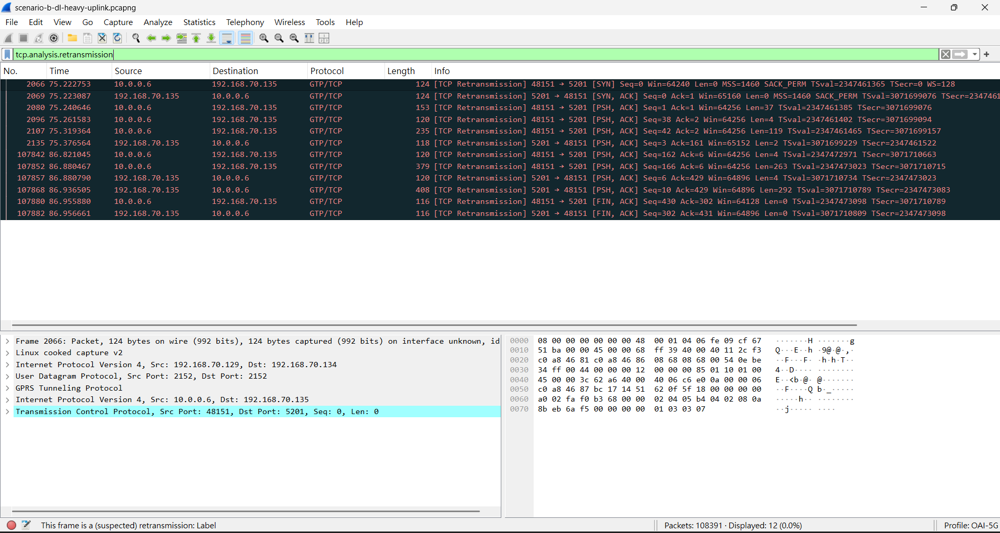
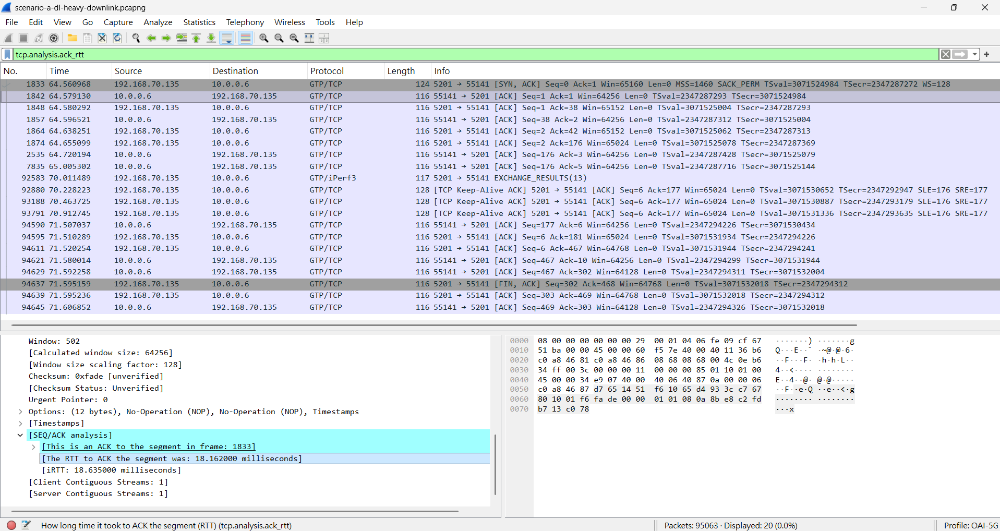
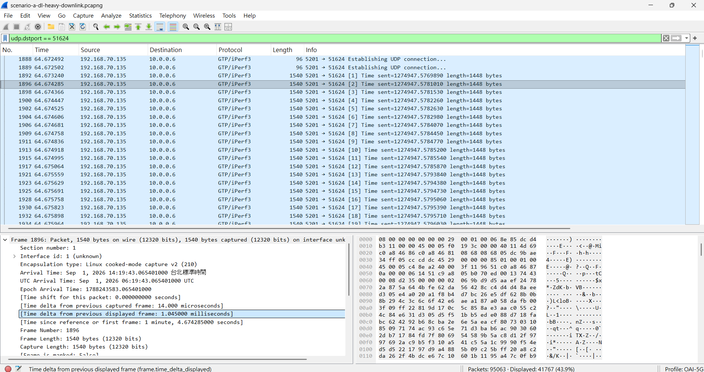

## Task 1 — Confirm the Traffic Direction

Complete the table:

| Scenario | Reverse value | Direction |
| --- | ---: | --- |
| A |reverse: 1 |downlink |
| B |reverse: 0 |uplink |
| C |reverse: 0 |uplink |

**Question:** Does the traffic direction shown in the JSON match the scenario description? Show the proof.
**Ans:** Yes
scenario description
| Scenario | TDD setting | Traffic direction | Main idea |
| --- | --- | --- | --- |
| A | DL-heavy | Downlink | The TDD setting favors the traffic direction |
| B | DL-heavy | Uplink | There are fewer opportunities for uplink traffic |
| C | Balanced | Uplink | More uplink opportunities are available than in B | 
 
A   
B   
C   

## Task 2 — Compare Throughput
Complete the table:

| Scenario | Direction | Throughput (Mbps) |
| --- | --- | ---: |
| A | Downlink |90.6541958358403 |
| B | Uplink |109.11724969037457 |
| C | Uplink |124.41674913023271 |

Answer:

1. What is the downlink throughput in Scenario A? 
 Ans：90.6541958358403Mbps
2. What is the uplink throughput in Scenario B?
 Ans：109.11724969037457Mbps
3. Is the uplink throughput higher in B or C?
 Ans：C
4. By approximately what percentage does C improve over B?
 Ans：(124.41674913023271 - 109.11724969037457) ÷ 109.11724969037457 × 100 = 14.0211556681%

## Task 3 — Check the Trade-off

Complete the table:

| Scenario | Throughput (Mbps) | Packet loss (%) | Jitter (ms) |
| --- | ---: | ---: | ---: |
| B |109.11724969037457 |0.23565878306653645 |0.11619665995310689 |
| C |124.41674913023271 |2.133919261135111 |0.16204804777679407 |

Answer:

1. Does C have higher uplink throughput than B?
 Ans： Yes
2. Does C have lower packet loss than B?
 Ans： No
3. What trade-off, if any, is visible when changing from B to C?
 Ans： Compared with Scenario B, Scenario C has **higher**  throughput, **higher**  packet loss, and **higher** jitter.These results suggest **that the balanced TDD setting gives the uplink more transmission opportunities and therefore more throughput, but in this test the higher sending rate also came with more lost packets and slightly more delay variation. Throughput improved, but stability became worse, so this is a throughput-versus-reliability trade-off.**

## Task 4 — Read SIB1 and Draw the TDD Configuration

### 4.3 Record the TDD Parameters

Complete the table for `pattern1`:

| Item | DL-heavy: A/B | Balanced: C |
| --- | --- | --- |
| Configuration capture filename | tdd-dl-heavy-sib1.pcapng | tdd-balanced-sib1.pcapng |
| SIB1 packet number |2 |2 |
| `referenceSubcarrierSpacing` (kHz) |30kHz |30kHz |
| `dl-UL-TransmissionPeriodicity` (ms) |5ms |2.5ms |
| `nrofDownlinkSlots` |7 |2 |
| `nrofDownlinkSymbols` |6 |6 |
| `nrofUplinkSlots` |2 |2 |
| `nrofUplinkSymbols` |4 |4 |
| Is `pattern2` present? |No |No |

### 4.4 Draw the TDD Time Allocation

| TDD setting | Repeating duration (ms) | Total reference slots | DL symbols | UL symbols | Flexible symbols | Configured UL symbol share (%) |
| --- | ---: | ---: | ---: | ---: | ---: | ---: |
| DL-heavy |5 |10 |104 |32 |4 |22.86 |
| Balanced |2.5 |5 |34 |32 |4 |45.71 |

| TDD setting | Repeating duration (ms) | Repetitions in 5 ms | DL symbols in 5 ms | UL symbols in 5 ms | Flexible symbols in 5 ms |
| --- | ---: | ---: | ---: | ---: | ---: |
| DL-heavy |5 |1 |104 |32 |4 |
| Balanced |2.5 |2 |68 |64 |8 |

**Question:** Can two patterns have the same UL symbol count per period but provide different numbers of UL symbols per unit time? Explain using your two tables.

 Ans：Yes. Both configurations have exactly 32 UL symbols per period (2 full UL slots + 4 UL symbols). However, the DL-heavy period is 5 ms, while the balanced period is only 2.5 ms. In a common 5 ms interval, the balanced pattern repeats twice and provides 64 UL symbols, whereas the DL-heavy pattern provides only 32. Therefore, the balanced setting offers twice as many configured UL symbols per unit time (45.71 % vs. 22.86 % of all symbols), even though the per-period UL count is the same.

### 4.5 Connect SIB1 to the Performance Results

Use the supplied mapping between the reference configuration captures and scenarios. Complete this table using Tasks 1–3 and your SIB1 analysis:

| Scenario | Reference TDD setting | JSON traffic direction | Configured UL symbol share (%) | Throughput (Mbps) | Packet loss (%) |
| --- | --- | --- | ---: | ---: | ---: |
| A | DL-heavy | Downlink | 22.86 | 90.65 | 0.44 |
| B | DL-heavy | Uplink | 22.86 | 109.12 | 0.24 |
| C | Balanced | Uplink | 45.71 | 124.42 | 2.13 |

Answer:

1. Which decoded TDD parameters differ between DL-heavy and balanced?
 Ans：Only two parameters differ: `dl-UL-TransmissionPeriodicity` (5 ms for DL-heavy vs. 2.5 ms for balanced) and `nrofDownlinkSlots` (7 vs. 2). The reference SCS (30 kHz), `nrofDownlinkSymbols` (6), `nrofUplinkSlots` (2), and `nrofUplinkSymbols` (4) are the same, and neither configuration has `pattern2`.

2. Which configuration provides more configured UL symbols per unit time? Support your answer with the diagram and calculated share.
 Ans：The balanced configuration. As the diagrams show, its UL block (slots 3–4 plus 4 UL symbols in slot 2) appears twice in every 5 ms, giving 64 UL symbols in 5 ms compared with 32 for DL-heavy. Its configured UL symbol share is 45.71 %, twice the 22.86 % of the DL-heavy setting.

3. How does that difference help explain the B/C throughput comparison?
 Ans：With twice as many configured UL symbols per unit time, the UE has more uplink transmission opportunities in Scenario C, which is consistent with the higher uplink throughput (124.42 Mbps vs. 109.12 Mbps). The improvement (+14 %) is much smaller than the 2× increase in UL resources, which shows that scheduling, radio conditions, overhead, and the offered load also limit the result. The TDD pattern is therefore a likely contributor, not proven to be the only cause.

4. Why can A and B use the same SIB1 TDD configuration even though their traffic directions differ?
 Ans：`tdd-UL-DL-ConfigurationCommon` is a cell-wide setting broadcast in SIB1, so it is independent of the direction of any particular application flow. Scenarios A and B simply run downlink and uplink iperf3 tests on the same DL-heavy cell; only the traffic direction changes, not the radio frame structure.

### Optional Observation — PRACH Configuration Index

| TDD setting | SIB1 packet number | PRACH configuration index |
| --- | ---: | ---: |
| DL-heavy | 2 | 98 |
| Balanced | 2 | 98 |

## Task 5 — Is the TDD Setting Suitable?

Complete the table using the supplied scenario mapping, the SIB1 reference configurations from Task 4, and your throughput results:

| Scenario | TDD setting | Traffic direction | Is the setting suitable for this direction? Why? |
| --- | --- | --- | --- |
| A | DL-heavy | Downlink |**Yes.** It provides 104 DL symbols per 5 ms (74 % of all symbols), giving many downlink transmission opportunities; A reached 90.65 Mbps with only 0.44 % loss. |
| B | DL-heavy | Uplink |**Not ideal for heavy uplink.** Only 32 UL symbols per 5 ms (22.86 %) are configured, so uplink opportunities are limited; B reached 109.12 Mbps, lower than C. |
| C | Balanced | Uplink | **More suitable for uplink.** It doubles the UL symbols to 64 per 5 ms (45.71 %), and C reached the highest uplink throughput (124.42 Mbps), although packet loss rose to 2.13 %. |

**Question:** Why might Scenario C achieve better uplink throughput than Scenario B? Refer to your SIB1 diagrams and measured results.

 Ans：In the DL-heavy diagram, only slots 8–9 and the last 4 symbols of slot 7 are UL in each 5 ms period. In the balanced diagram, the same UL block occurs every 2.5 ms, so there are 64 instead of 32 UL symbols in 5 ms. More UL resources give the scheduler more chances to grant uplink transmissions, which is consistent with C's 124.42 Mbps compared with B's 109.12 Mbps (+14 %). The gain is not proportional because other factors such as scheduling, radio quality, and overhead also matter.

## Task 6 — Find GTP-U Information

Record the following information from one packet:

| Item | Value |
| --- | --- |
| Scenario capture filename | `scenario-a-dl-heavy-downlink.pcapng` |
| Packet number | 1892 |
| Outer source IP | 192.168.70.134 |
| Outer destination IP | 192.168.70.129 |
| Inner source IP | 192.168.70.135 |
| Inner destination IP | 10.0.0.6 |
| TEID | 0xcddc4529 (3453764905) |

## Task 7 — TCP Retransmissions
Record the number of displayed packets:

| Scenario | Displayed TCP retransmissions |
| --- | ---: |
| A | 14 |
| B | 12 |
| C | 12 |

**Question:** Do these TCP retransmissions directly represent lost UDP performance packets?

 Ans：No. All displayed retransmissions belong to the iperf3 TCP control connection on port 5201 (for example, A uses 10.0.0.6:55141 ↔ 192.168.70.135:5201), and they are clustered around the start and end of each test (for A, at 64.56–64.95 s and 71.51 s), when iperf3 exchanges test parameters, state messages, and results. The performance data is sent over UDP, which is never retransmitted. UDP loss must be read from the iperf3 JSON (`lost_packets` / `lost_percent`), e.g. 111 lost packets in B and 1,146 in C, which do not match the TCP retransmission counts.

## Task 8 — RTT and Packet Interval

Select one packet from the iperf3 TCP control connection and record its ACK RTT:

| Scenario | Packet number | Example TCP ACK RTT |
| --- | ---: | --- |
| A | 1842 | 0.018162 s |

### Packet Interval

Record the scenario, display filter, packet numbers, and time interval.

| Scenario | Display filter | Packet numbers | Time interval |
| --- | --- | --- | --- |
| A | `udp.dstport == 51624` | 1892 → 1896 | 1.045 ms |

## Final Questions

Answer each question in two or three sentences:

1. Does Scenario A use a TDD setting that matches its traffic direction?
 Ans：Yes. Scenario A is a downlink test (`reverse: 1`) on the DL-heavy setting, which provides 104 DL symbols out of 140 in each 5 ms period. This large DL share matches the traffic direction, and A achieved 90.65 Mbps with low packet loss (0.44 %).

2. Why is Scenario B expected to have limited uplink resources? Cite a parameter or count from the DL-heavy SIB1 reference configuration.
 Ans：In the DL-heavy SIB1, `nrofDownlinkSlots` is 7 but `nrofUplinkSlots` is only 2 (plus `nrofUplinkSymbols` = 4) in a 5 ms period. This gives only 32 UL symbols out of 140 (22.86 %), so an uplink-heavy test like B has relatively few uplink transmission opportunities.

3. How much does uplink throughput change from B to C?
 Ans：Uplink throughput increases from 109.12 Mbps in B to 124.42 Mbps in C, an increase of 15.30 Mbps, or about 14.0 %. This gain comes with the balanced setting, which doubles the configured UL symbols per 5 ms.

4. What negative result, if any, is visible in C? Support your answer with packet loss or jitter values.
 Ans：Packet loss increased sharply from 0.24 % (111 packets) in B to 2.13 % (1,146 packets) in C, about nine times higher. Jitter also rose slightly, from 0.116 ms to 0.162 ms.

5. Why can increasing UL resources improve uplink throughput?
 Ans：More UL symbols per unit time give the gNB scheduler more opportunities to grant uplink transmissions to the UE. In this lab, the balanced setting provides 64 UL symbols per 5 ms instead of 32, so the UE can send more data in the same time, which is consistent with C's higher throughput.

6. Is adding more UL resources always the best solution? Explain using throughput and packet loss.
 Ans：No. Scenario C gained 14 % throughput but its packet loss rose from 0.24 % to 2.13 %, and the balanced setting also cuts DL symbols from 104 to 68 per 5 ms, which would reduce downlink capacity. The best TDD setting depends on the traffic mix and the required reliability, not only on peak uplink throughput.

7. Suggest one simple follow-up test that could improve throughput without producing too much packet loss.
 Ans：Keep the balanced TDD setting and repeat the uplink test with several iperf3 target bitrates (for example `-b 100M`, `110M`, `115M`, `120M`), running each rate several times. This finds the highest bitrate that still keeps packet loss below an acceptable level (e.g., 1 %), instead of pushing the link until it drops packets.

8. What can the configuration captures tell you that the iperf3 JSON cannot? Why are separately recorded configuration captures not direct proof of the configuration during an earlier test?
 Ans：The configuration captures contain the SIB1 broadcast, so they show the actual TDD parameters (SCS, period, numbers of DL/UL slots and symbols), while the iperf3 JSON only reports application-level results such as direction, throughput, loss, and jitter. However, these captures were recorded separately during an initial cell access, not at the same time as the iperf3 runs, so they only show what the gNB broadcast when they were captured; the gNB could have been configured differently during the original tests.

