## Goal

In the previous labs, you analyzed 5G signaling messages and network performance using provided captures and measurements.

In this lab, you will deploy your own 5G Standalone (SA) network using OpenAirInterface (OAI), verify the complete connection, investigate RFsimulator communication, perform active network measurements, and troubleshoot a controlled connection failure.

Unlike the previous labs, you will collect measurements directly from your own running 5G network.


## Task 1 — Deploy and Verify the Complete 5G SA Network

| Stage | Successful? | Evidence from logs |
| --- | --- | --- |
| CN5G initialization | Yes | 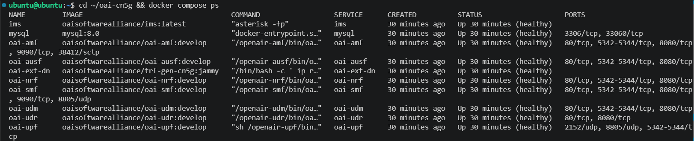 |
| gNB NG Setup | Yes | 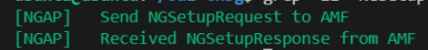 |
| UE synchronization | Yes | 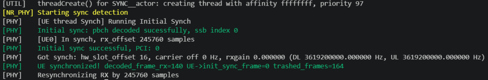 |
| RRC connection establishment | Yes | 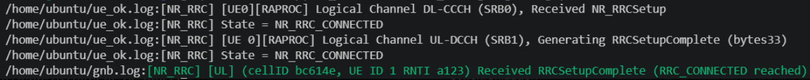 |
| UE Registration | Yes | 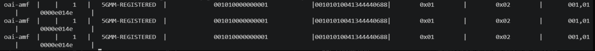 |
| PDU Session Establishment | Yes | 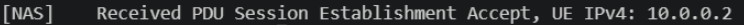 |
| UE tunnel creation | Yes | 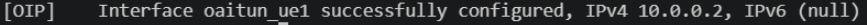 |

**Questions:**

1. Does a successful NG Setup guarantee that a UE can register? Explain.

   **Ans：** No. NG Setup only sets up the NGAP association between the gNB and the AMF. During it they exchange the gNB ID, the supported PLMN/TAC, and the slices (S-NSSAI). It shows that the gNB can reach the AMF, but it does not check anything about a particular UE. UE registration also needs the subscriber to exist in the UDM/UDR, the right security credentials (K, OPc) on the SIM, and a PLMN and NSSAI that the network allows. Any of these can fail even when NG Setup succeeded.

2. Why can the UE establish an RRC connection but still fail Registration?

   **Ans：** RRC is an Access Stratum procedure between the UE and the gNB only. The gNB accepts the RRC Setup without knowing who the subscriber is. Registration is a NAS procedure between the UE and the AMF, and it needs the core network to identify the UE (SUCI/SUPI), authenticate it through 5G-AKA (AMF → AUSF → UDM/UDR), and run NAS security. If the IMSI is not provisioned, the keys do not match, or the PLMN/slice is not allowed, the AMF rejects the registration even though the radio connection is working.

3. What additional procedure is required after Registration before user data can be exchanged?

   **Ans：** A PDU Session Establishment is required. The UE sends a PDU Session Establishment Request to the AMF, which forwards it to the SMF. The SMF picks a UPF, assigns the UE an IP address (here 10.0.0.x), and sets up forwarding rules on the UPF over PFCP (N4). The AMF then asks the gNB to set up PDU session resources (N2). The gNB configures a data radio bearer with the UE through RRC Reconfiguration and opens a GTP-U tunnel to the UPF (N3). Only after this does the UE get a working `oaitun_ue1` interface for user data.


## Task 2 — Investigate RFsimulator Communication

Complete the table:

| Item | Observed Value |
| --- | --- |
| gNB process ID | 156377 |
| nrUE process ID | 157587 |
| RFsimulator transport protocol | TCP |
| RFsimulator port | 4043 |
| TCP connection state | ESTAB |
| Connected process(es) | `nr-softmodem` (156377) ↔ `nr-uesoftmodem` (157587) |

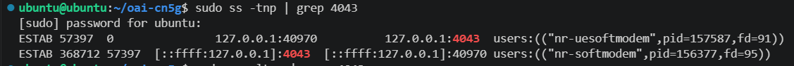

**Questions:**

1. Why does RFsimulator use a TCP connection instead of a physical antenna?

   **Ans：** The experiment has no RF hardware such as a USRP, so there is no DAC/ADC and nothing to transmit over the air. RFsimulator replaces the RF front end with a socket: the time-domain baseband IQ samples that would normally go to the radio are written to a TCP connection, and the other side reads them as if it had received them. TCP gives reliable, in-order delivery, so samples are not lost or reordered, and it also lets the gNB and UE run as separate processes on one machine or on different machines.

2. Are the TCP packets exchanged by RFsimulator the same as the UE's application-layer IP packets?

   **Ans：** No. The RFsimulator TCP stream carries raw IQ samples for every slot, including synchronization signals, PBCH, control channels (PDCCH/PUCCH), reference signals, and empty slots. The UE's IP packets (for example the ICMP pings) first go through SDAP, PDCP, RLC, and MAC, then get channel coded, modulated, and mapped onto OFDM symbols. Only after that do they become part of the IQ samples. On the network side, user data leaves the gNB in a separate GTP-U/UDP tunnel to the UPF, which is not the RFsimulator connection at all.

3. Does using RFsimulator mean that the UE and gNB are performing no physical-layer processing?

   **Ans：** No. Both sides still run the full NR physical layer: LDPC/Polar encoding and decoding, scrambling, QAM modulation and demodulation, OFDM IFFT/FFT with cyclic prefix, SSB-based synchronization, channel estimation, and HARQ. RFsimulator replaces only the RF hardware and the radio channel. By default it is an ideal, noise-free channel, although it can apply simulated channel models. This is why PHY processing still takes a large share of the CPU.


## Task 3 — Verify End-to-End Connectivity

| Measurement | Observed Value |
| --- | --- |
| UE IP address | 10.0.0.2 |
| Destination IP | 192.168.70.135 |
| Packets transmitted | 10 |
| Packets received | 10 |
| Packet loss (%) | 0 |
| Minimum RTT (ms) | 5.138 |
| Average RTT (ms) | 5.793 |
| Maximum RTT (ms) | 6.589 |

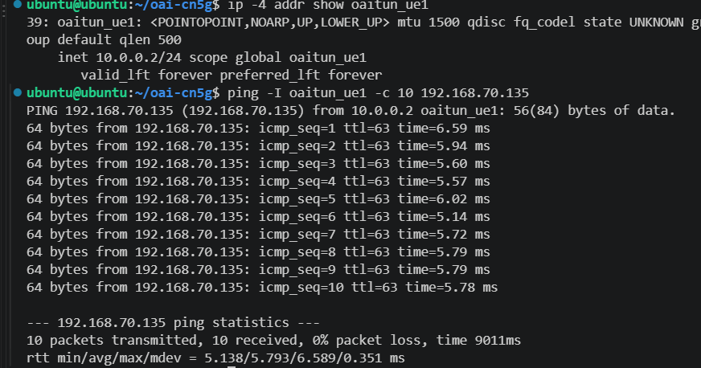

**Questions:**

1. Why must Ping use the `oaitun_ue1` interface in this experiment?

   **Ans：** `oaitun_ue1` is the UE's user-plane interface. Packets sent through it go UE → gNB → GTP-U → UPF → data network. The host machine itself is attached directly to the `oai-cn5g` Docker bridge (192.168.70.129), so a ping without `-I oaitun_ue1` would reach 192.168.70.135 directly through the host's routing table and skip the 5G system entirely. Binding the ping to `oaitun_ue1` makes the traffic use the UE's address (10.0.0.x) and the 5G PDU session.

2. Does successful Registration guarantee successful user-plane connectivity?

   **Ans：** No. Registration is a control-plane procedure. It only shows that the UE has been authenticated and is known to the AMF. User-plane connectivity also needs a successful PDU session (SMF and UPF selection, IP allocation), a data radio bearer, a working N3 GTP-U tunnel, correct UPF forwarding rules, and a return route from the data network back to the UE subnet. Any of these can fail after a successful registration.

3. What does a successful Ping prove, and what does it not prove?

   **Ans：** A successful ping proves that the whole chain works end to end: registration, authentication, PDU session establishment, IP allocation, the radio bearer, NR PHY/MAC processing on both sides, GTP-U tunneling, UPF forwarding, and routing back from the DN. It does not prove anything about real radio performance, such as behavior under fading, interference, noise, or hardware impairments. It also says nothing about achievable throughput, real over-the-air latency, mobility or handover, multi-UE capacity, or whether commercial UEs would work with this setup.


## Task 4 — Investigate the Effect of Packet Size


| Scenario | ICMP Payload | Avg. RTT (ms) | Max. RTT (ms) | Packet Loss (%) |
| --- | ---: | ---: | ---: | ---: |
| A | 56 bytes | 5.840 | 6.533 | 0 |
| B | 512 bytes | 6.664 | 9.115 | 0 |
| C | 1200 bytes | 7.234 | 9.067 | 0 |

A   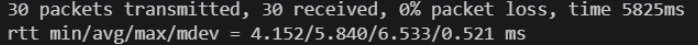
B   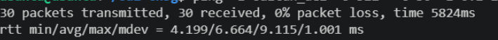
C   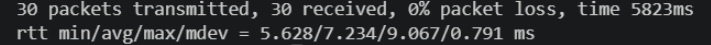

Calculate the RTT difference:

```text
RTT Difference = Average RTT(C) - Average RTT(A)
               = 7.234 - 5.840
               = 1.394 ms
```

**Questions:**

1. Which scenario has the highest average RTT?

   **Ans：** Scenario C (1200-byte payload) had the highest average RTT, 7.234 ms. That is 1.394 ms (about 24%) higher than Scenario A (5.840 ms) and 0.570 ms higher than Scenario B (6.664 ms).

2. Does increasing packet size always increase RTT in your measurements?

   **Ans：** Not always. The average RTT did rise steadily with payload size, from 5.840 ms (A) to 6.664 ms (B) to 7.234 ms (C). The maximum RTT did not follow that pattern: Scenario B had the highest maximum (9.115 ms), slightly above Scenario C (9.067 ms). So individual packets are also affected by timing factors that have nothing to do with size, such as which slot a packet arrives in, when the uplink grant comes, and CPU scheduling. In addition, the overall increase is small, about 1.4 ms across a 21-fold change in payload, and only 30 samples were taken per scenario. The trend in the averages is clear, but packet size is not the only thing that determines RTT.

3. Why might a larger packet require more transmission or processing resources?

   **Ans：** A larger IP packet produces a larger MAC transport block. That block needs more PRBs or a higher MCS, and once it exceeds the LDPC code-block size limit it is split into several code blocks. Each code block has to be encoded, rate-matched, modulated, and then demodulated and decoded on the other side. The ping also crosses the radio link twice (uplink request and downlink reply), so this extra work happens in both directions. In RFsimulator the whole PHY runs in software, so this shows up as extra CPU time on both the gNB and the UE. More IQ data is also copied through the TCP socket, and the GTP-U tunnel carries more bytes. The largest packet, 1200 bytes of payload plus 28 bytes of ICMP/IP headers plus about 36 bytes of GTP-U/UDP/IP overhead, still fits under the 1500-byte MTU, so IP fragmentation did not contribute to the increase.

4. What factors other than packet size could affect RTT in a software-based 5G network?

   **Ans：**
   - TDD frame structure: uplink data has to wait for an uplink slot, which adds up to several slots (0.5 ms each at 30 kHz SCS) of delay.
   - Uplink access procedure: the scheduling request, buffer status report, and grant exchange the UE has to go through before it can send.
   - HARQ retransmissions and the `min_rxtxtime` setting (6 slots in this experiment).
   - CPU load and OS thread scheduling, especially in a VM where the gNB, UE, and core all share 4 cores.
   - Whether RFsimulator keeps up with real time.
   - Docker bridge networking and UPF processing.
   - The ping interval (`-i 0.2`) relative to the slot timing.

   The maximum RTT varied by more than 3 ms within each scenario (for example, 5.840 ms average versus 9.115 ms maximum in Scenario B). This shows that these timing factors cause more variation than packet size does.

5. Can these results be interpreted as real over-the-air 5G latency? Explain.

   **Ans：** No. RFsimulator carries IQ samples over a local TCP socket. There is no RF front end, no propagation delay, and by default no noise, fading, or interference, so link adaptation and error-driven HARQ retransmissions never come into play. Timing also depends on how fast the host CPU can run the software PHY, rather than on radio hardware with a precise clock. On a different machine or under a different load, the same configuration could give different RTTs. These measurements of about 5.8–7.2 ms mainly reflect protocol processing and scheduling delay in this particular software setup. They are useful for comparing scenarios within this setup, but they do not represent the latency a commercial UE would see on a real n78 cell.


## Task 5 — Diagnose a Controlled UE Registration Failure

Complete the table:

| Item | Observation |
| --- | --- |
| Modified parameter | `--uicc0.imsi 001010000000099` |
| UE synchronized with gNB? | Yes |
| RRC connection established? | Yes |
| Registration successful? | No |
| Error or rejection evidence | AUSF: `Resource corresponding to User imsi-001010000000099 not found` (`CONTEXT_NOT_FOUND`, 404); AMF: `Request Authentication Vectors failure` → `5GMM-DEREGISTERED` (event: `REGISTRATION_REJECT_SENT`); UE: `Received NAS_DOWNLINK_DATA_IND type FGS_REGISTRATION_REJECT` |
| Likely cause | IMSI 001010000000099 is not provisioned in the UDR, so UDM/AUSF cannot generate authentication vectors and the AMF rejects the registration |

**Failed connection**

UE   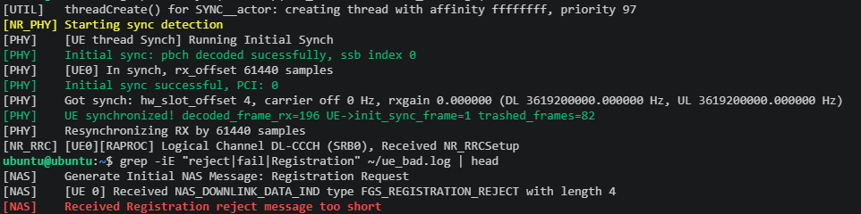
AUSF   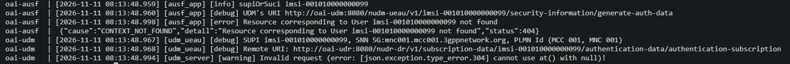
AMF   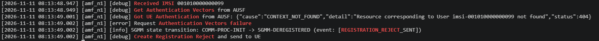

**Recovered connection**

UE   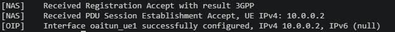
Ping   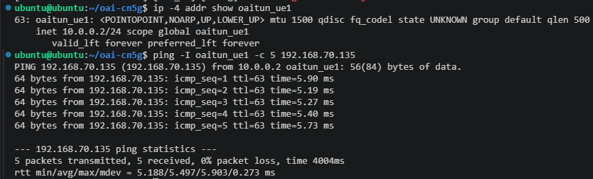

**Questions:**

1. Why can the UE potentially synchronize with the gNB even when the IMSI is incorrect?

   **Ans：** Synchronization only uses signals that the gNB broadcasts to every UE in the cell: PSS, SSS, and PBCH in the SSB, plus SIB1. To decode them the UE only needs the right band, carrier frequency, numerology, and bandwidth, and the IMSI is not used at all. The IMSI is not checked during random access or RRC Setup either. It is first sent inside the NAS Registration Request (as a SUCI) and only the 5G core checks it. My logs confirm this: with IMSI 001010000000099 the UE still printed `Initial sync successful, PCI: 0` and `Received NR_RRCSetup`, and only afterwards received a Registration Reject.

2. Which network function is involved in UE authentication?

   **Ans：** The AUSF (Authentication Server Function) performs 5G-AKA authentication. It gets authentication vectors from the UDM, which reads the subscriber's credentials (K, OPc, SQN) from the UDR. The AMF, acting as the SEAF, starts authentication and exchanges the challenge and response with the UE. In my failed run, the AUSF reported `Resource corresponding to User imsi-001010000000099 not found` (`CONTEXT_NOT_FOUND`, 404). The AMF then logged `Request Authentication Vectors failure` and sent a Registration Reject.

3. Why does changing an IMSI affect Registration but not the RFsimulator TCP connection itself?

   **Ans：** The IMSI is a NAS-layer subscriber identity, so it only matters between the UE and the 5G core (AMF/AUSF/UDM). The RFsimulator TCP connection on port 4043 sits below the physical layer and just carries IQ samples between the `nr-softmodem` and `nr-uesoftmodem` processes. It knows nothing about subscribers, so the TCP connection, synchronization, and RRC all work normally, and the failure only happens at the NAS layer when the core cannot find the subscriber.

4. What evidence proves that restoring the correct configuration solved the problem?

   **Ans：** After restarting the UE with only the IMSI changed back to 001010000000001, the UE log showed `Received Registration Accept with result 3GPP` and `Received PDU Session Establishment Accept, UE IPv4: 10.0.0.2`. It also showed `Interface oaitun_ue1 successfully configured, IPv4 10.0.0.2`. A ping from `oaitun_ue1` to 192.168.70.135 then succeeded with 5/5 packets received and 0% packet loss (average RTT 5.832 ms). Because the IMSI was the only parameter changed between the failed and recovered runs, this shows that the unprovisioned IMSI caused the failure.


## Task 7 — Explain the Relationship Between Simulation and Real 5G

Complete the comparison:

| Feature | OAI RFsimulator | Physical 5G System |
| --- | --- | --- |
| gNB and UE protocol stack | Full NR stack (SDAP/PDCP/RLC/MAC/PHY, RRC, NAS) running as software processes | The same 3GPP stack, implemented in commercial gNB and UE software or hardware |
| OFDM signal processing | Done in software on the CPU (IFFT/FFT, CP, QAM, LDPC/Polar coding) | Done in DSP/ASIC/FPGA, followed by a real RF chain |
| Physical antennas | None; IQ samples are carried over a TCP socket (port 4043) | Real antennas and RF front ends (PA, LNA, filters, ADC/DAC) |
| RF hardware impairments | None by default (no phase noise, CFO, IQ imbalance, or PA nonlinearity) | Present; they must be estimated and compensated for |
| Wireless propagation effects | Ideal, noise-free channel by default; simulated channel models are optional | Path loss, multipath fading, Doppler, shadowing, interference, and noise |
| 5G Core connectivity | Real OAI CN5G (AMF, SMF, UPF, AUSF, UDM, and others) in Docker, using standard NGAP/NAS/PFCP/GTP-U | A real 5GC with the same standard interfaces, often from a commercial vendor |

**Questions:**

1. Which parts of the 5G system remain functional when physical RF hardware is replaced with RFsimulator?

   **Ans：** Almost everything except the RF front end and the radio channel still works. This includes:
   - the full NR protocol stack on the gNB and UE,
   - baseband PHY processing (channel coding, modulation, OFDM, synchronization, HARQ),
   - RRC and NAS signaling, including registration and 5G-AKA authentication,
   - PDU session establishment,
   - the whole 5G core with its NGAP, PFCP, and GTP-U interfaces.

   My experiment showed this end to end: the UE synchronized, registered, got IP 10.0.0.2, and pinged the DN with 0% loss.

2. Why is RFsimulator useful for testing the 5G protocol stack?

   **Ans：** It needs no SDR hardware, no licensed spectrum, and no RF expertise, and everything runs on a single PC, so it is cheap and easy to set up. The ideal channel can be reproduced exactly, so protocol or configuration errors can be told apart from radio problems. It suits teaching, debugging, automated CI testing, and checking new features before trying them over the air. For example, the IMSI failure in Task 5 could be reproduced and diagnosed in minutes without touching any hardware.

3. Why might latency and throughput differ between RFsimulator and a real 5G deployment?

   **Ans：** In RFsimulator, timing depends on how fast the host CPU can run the software PHY and how fast the TCP socket moves IQ samples, not on a precise radio clock. A busy machine or VM, like this 4-core VM that also runs the 5G core, can slow processing down and add jitter. On the other hand, the channel is ideal: there is no propagation delay, fading, interference, or error-driven HARQ retransmission, and no other users share the resources. A real deployment adds all of these, along with link adaptation and hardware processing limits, so its latency and throughput could be better or worse than what I measured (about 5.8–7.2 ms RTT).

4. What would need to change if you wanted to test a physical UE instead of OAI nrUE?

   **Ans：**
   - Replace `--rfsim` with a real SDR (for example a USRP B210) with antennas and an accurate clock source (GPSDO or a stable reference).
   - Use a band and frequency the phone supports, with legal spectrum access or a shielded RF enclosure.
   - Program a SIM card whose IMSI, K, OPc, and PLMN match a subscriber in the CN5G database.
   - Tune the gNB configuration (TDD pattern, SSB position, bandwidth, timing) so the commercial UE accepts the cell.
   - Run on a host that can meet real-time processing deadlines.


## Final Analysis

1. Describe the complete process from starting the OAI 5GC to successful user-plane connectivity.

   **Ans：** First, I started the CN5G containers (MySQL, NRF, UDR, UDM, AUSF, AMF, SMF, UPF, and the external DN) with Docker Compose, and all of them became healthy. Next, the gNB connected to the AMF over SCTP, completed NG Setup, and began broadcasting SSB and SIB1 over RFsimulator, listening on TCP port 4043. The nrUE then connected to that port, synchronized to the SSB (`Initial sync successful, PCI: 0`), did random access, set up an RRC connection, and sent a NAS Registration Request. After 5G-AKA authentication through the AMF, AUSF, and UDM, the UE received a Registration Accept. It then completed PDU Session Establishment through the SMF and UPF and got IP 10.0.0.2 on `oaitun_ue1`. Finally, pinging 192.168.70.135 through `oaitun_ue1` succeeded with 0% loss, which proved end-to-end user-plane connectivity.

2. Explain the difference between an RFsimulator TCP connection and a 5G PDU Session.

   **Ans：** The RFsimulator TCP connection is a transport inside the simulator that stands in for the radio link. In my setup it ran between `nr-softmodem` (PID 156377, listening on port 4043) and `nr-uesoftmodem` (PID 157587), carrying raw baseband IQ samples. It knows nothing about subscribers or IP addresses, and it exists even when registration fails, as Task 5 showed. A PDU session is a 5G logical connection set up by the SMF after successful registration. It gives the UE an IP address (10.0.0.2) and a user-plane path: UE → data radio bearer → gNB → N3 GTP-U tunnel → UPF → DN. The UE's IP packets travel inside the PDU session, and only after being processed by the whole NR stack do they become IQ samples on the RFsimulator connection.

3. Based on your measurements, how did packet size affect RTT and packet loss?

   **Ans：** The average RTT rose with payload size, from 5.840 ms (56 bytes) to 6.664 ms (512 bytes) to 7.234 ms (1200 bytes). The difference between C and A was 1.394 ms, about 24%. The maximum RTT did not follow the same order: Scenario B had a slightly higher maximum (9.115 ms) than Scenario C (9.067 ms). This shows that individual packets are also affected by slot timing, uplink grant timing, and CPU scheduling. Packet loss was 0% in all three scenarios, so in this ideal simulated channel, larger packets caused a modest increase in processing delay but no extra loss.

4. Describe the registration failure you introduced and explain how you diagnosed and recovered from it.

   **Ans：** I restarted the nrUE with IMSI 001010000000099 instead of 001010000000001 and left every other UE parameter, the gNB, and the CN5G database unchanged. The UE log showed `Initial sync successful` and `Received NR_RRCSetup`, so the radio link and the RFsimulator connection were working. However, the UE then received `FGS_REGISTRATION_REJECT`. In the core-network logs, the AUSF reported `Resource corresponding to User imsi-001010000000099 not found` (`CONTEXT_NOT_FOUND`, 404), and the AMF logged `Request Authentication Vectors failure` followed by `REGISTRATION_REJECT_SENT`. This showed that the subscriber was not provisioned in the UDR. After restarting the UE with the original IMSI, it received a Registration Accept and a PDU Session Establishment Accept, got IP 10.0.0.2, and pinged the DN with 0% loss.

5. Identify two limitations of this simulated environment and explain how they might affect experimental results.

   **Ans：** First, RFsimulator uses an ideal channel with no RF impairments, path loss, fading, or interference. Link adaptation, error-driven HARQ retransmissions, and cell-edge behavior are therefore never exercised, which is why I saw 0% packet loss in every test; a real air interface would probably show more loss and more variation. Second, the gNB, UE, and the whole 5G core all share the CPU of one 4-core VM, and the PHY timing is driven by software rather than radio hardware. The measured RTTs (about 5.8–7.2 ms, with spikes up to about 9 ms) therefore depend on CPU load and VM scheduling, so they could change between runs or machines and cannot be generalized to real n78 latency.
