## Goal

In Lab 3, the gNB ran as a single monolithic `nr-softmodem` process. In this lab, the gNB is split into a **gNB-CU** and a **gNB-DU** connected by the F1 interface.

I deployed the split RAN with OAI v2.4.0 and RFsimulator, connected the nrUE to the same OAI CN5G, and recorded both **F1-C** (F1AP over SCTP) and **F1-U** (GTP-U over UDP) in a single PCAP file (`lab4-f1-complete.pcap`). I then used the capture to follow F1 Setup, the UE's RRC/NAS signaling, the UE Context procedures, and the user-plane GTP-U tunnel between the DU and the CU.

All values, packet numbers, and TEIDs below come from my own run.


## Task 1 — Inspect the Split Configurations

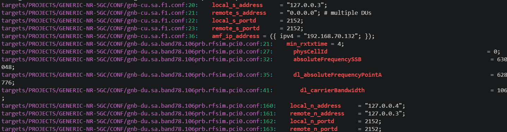

| Parameter | gNB-CU (`gnb-cu.sa.f1.conf`) | gNB-DU (`gnb-du.sa.band78.106prb.rfsim.pci0.conf`) |
| --- | --- | --- |
| F1-C local address | `local_s_address = 127.0.0.3` | `local_n_address = 127.0.0.4` |
| F1-C remote address | `remote_s_address = 0.0.0.0` (accepts any DU) | `remote_n_address = 127.0.0.3` |
| F1-U GTP-U port | `local_s_portd = 2152`, `remote_s_portd = 2152` | `local_n_portd = 2152`, `remote_n_portd = 2152` |
| AMF address (N2) | `amf_ip_address = 192.168.70.132` | — |
| CU N2 / N3 address | `GNB_IPV4_ADDRESS_FOR_NG_AMF / NGU = 192.168.70.129` | — |
| `absoluteFrequencySSB` | — | `630048` (3,450.72 MHz) |
| `dl_absoluteFrequencyPointA` | — | `628776` (3,431.64 MHz) |
| `dl_carrierBandwidth` | — | `106` PRBs |
| `physCellId` | — | `0` |
| `min_rxtxtime` | — | `4` |

Frequency check:

```text
F(MHz) = 3000 + 0.015 × (NR-ARFCN − 600000)      (FR1, 3–24.25 GHz range)

SSB    : 3000 + 0.015 × (630048 − 600000) = 3450.72 MHz   → UE: -C 3450720000
Point A: 3000 + 0.015 × (628776 − 600000) = 3431.64 MHz
Lab 3  : 3000 + 0.015 × (641280 − 600000) = 3619.20 MHz   → not valid for this DU
```

The DU log confirms that it loaded these values: `Read in ServingCellConfigCommon (PhysCellId 0, ABSFREQSSB 630048, DLBand 78, ABSFREQPOINTA 628776, DLBW 106 ...)`.

**Questions:**

1. Which protocol layers mainly reside in the CU, and which reside in the DU?

   **Ans：** The CU contains the higher layers: **RRC** and **PDCP** (plus SDAP on the user plane). It also terminates the interfaces to the core: N2 (NGAP to the AMF) and N3 (GTP-U to the UPF). The DU contains the lower, time-critical layers: **RLC**, **MAC**, and **PHY**, together with the RFsimulator radio front end. This is the 3GPP "Option 2" split. My logs match it: the CU connected to the AMF (`Received NGSetupResponse from AMF`) and opened a GTP-U socket on `192.168.70.129:2152` for N3, while the DU initialized the PHY/RU threads and the RFsimulator.

2. What is the purpose of the F1 interface?

   **Ans：** F1 connects one gNB-CU to one or more gNB-DUs, so together they appear to the UE and to the 5GC as a single gNB. It has two parts:
   - **F1-C** (F1AP over SCTP) carries control signaling: F1 Setup, DU configuration updates, UE Context Setup/Modification/Release, and the RRC messages that the DU relays between the UE and the CU (inside RRC containers).
   - **F1-U** (GTP-U over UDP) carries the UE's user-plane data (PDCP PDUs) for each data radio bearer between the CU's PDCP and the DU's RLC.

3. Why must the UE radio frequency be compatible with the DU rather than taken blindly from the previous lab?

   **Ans：** In the split architecture, the DU owns the PHY, so the DU configuration decides where the SSB and the carrier are placed. The UE must search for the SSB at the frequency the DU actually transmits on. The Lab 3 monolithic config used `absoluteFrequencySSB = 641280` (3,619.20 MHz), but this DU uses `630048` (3,450.72 MHz), which is about 168 MHz lower. With the old `-C 3619200000`, the UE would search the wrong frequency and never find the SSB, so it could not decode MIB/SIB1 or start random access. With `-C 3450720000`, the UE log showed `Initial sync successful, PCI: 0`.


## Task 2 — Deploy the Split 5G SA Network

| Stage | Successful? | Evidence from logs |
| --- | --- | --- |
| CN5G initialization | Yes | 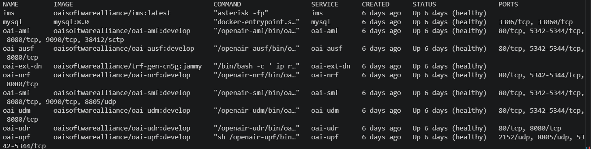 |
| gNB-CU NG Setup and F1 Setup acceptance | Yes | 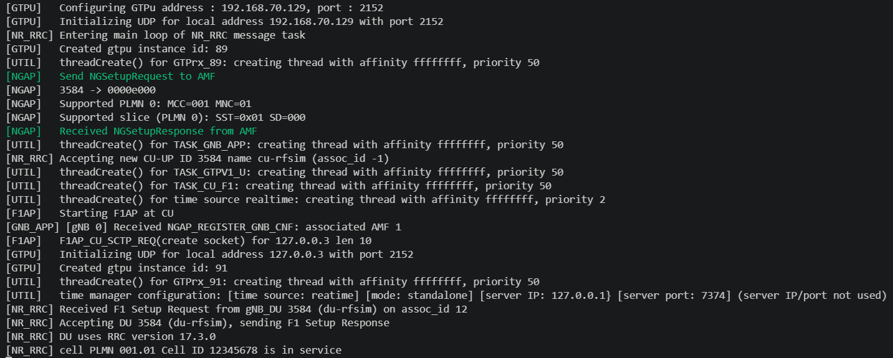 |
| gNB-DU F1 Setup | Yes | 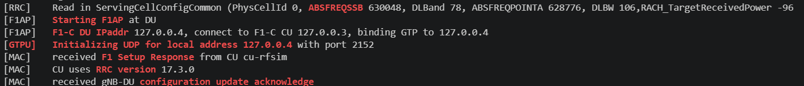 |
| UE sync, RRC, Registration, PDU Session | Yes | 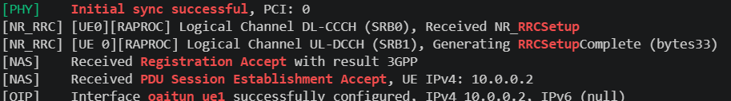 |
| UE tunnel creation | Yes | 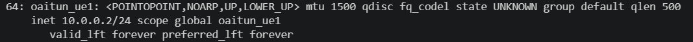 |
| End-to-end Ping | Yes | 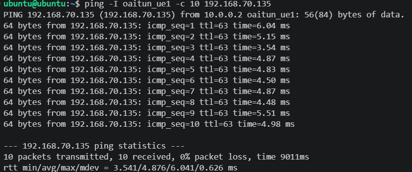 |

Key log lines:

| Node | Log line | Meaning |
| --- | --- | --- |
| CU | `Send NGSetupRequest to AMF` / `Received NGSetupResponse from AMF` | N2 (NGAP) association with the AMF is up |
| CU | `Initializing UDP for local address 192.168.70.129 with port 2152` | N3 GTP-U endpoint toward the UPF |
| CU | `F1AP_CU_SCTP_REQ(create socket) for 127.0.0.3` | CU listens for F1-C |
| CU | `Initializing UDP for local address 127.0.0.3 with port 2152` | F1-U GTP-U endpoint on the CU side |
| CU | `Received F1 Setup Request from gNB_DU 3584 (du-rfsim)` / `Accepting DU 3584 (du-rfsim), sending F1 Setup Response` | F1 Setup accepted |
| CU | `cell PLMN 001.01 Cell ID 12345678 is in service` | Cell is active |
| DU | `F1-C DU IPaddr 127.0.0.4, connect to F1-C CU 127.0.0.3, binding GTP to 127.0.0.4` | DU F1 endpoints |
| DU | `received F1 Setup Response from CU cu-rfsim` / `received gNB-DU configuration update acknowledge` | F1 Setup and DU Configuration Update completed |
| UE | `Initial sync successful, PCI: 0` | UE found the DU's SSB |
| UE | `Received NR_RRCSetup` / `Generating RRCSetupComplete` | RRC connection established |
| UE | `Received Registration Accept with result 3GPP` | Registration succeeded |
| UE | `Received PDU Session Establishment Accept, UE IPv4: 10.0.0.2` | PDU session established |
| UE | `Interface oaitun_ue1 successfully configured, IPv4 10.0.0.2` | UE tunnel created |

Connectivity results:

| Measurement | Observed Value |
| --- | --- |
| UE IP address | 10.0.0.2/24 (`oaitun_ue1`) |
| Destination IP | 192.168.70.135 |
| Packets transmitted | 10 |
| Packets received | 10 |
| Packet loss (%) | 0 |
| Minimum RTT (ms) | 3.541 |
| Average RTT (ms) | 4.876 |
| Maximum RTT (ms) | 6.041 |
| mdev (ms) | 0.626 |


## Task 3 — Capture F1-C and F1-U in a Single PCAP

The capture was started on `lo` **after** the CU but **before** the DU, so the SCTP association and F1 Setup were recorded:

```bash
sudo tcpdump -i lo -s 0 -nn -w ~/lab4/lab4-f1-complete.pcap \
  'host 127.0.0.3 and host 127.0.0.4 and (sctp or udp port 2152)'
```


Traffic used to generate F1-U packets (in addition to the 10-packet ping in Task 2):

```bash
ping -I oaitun_ue1 -c 30 -i 0.2 192.168.70.135
```

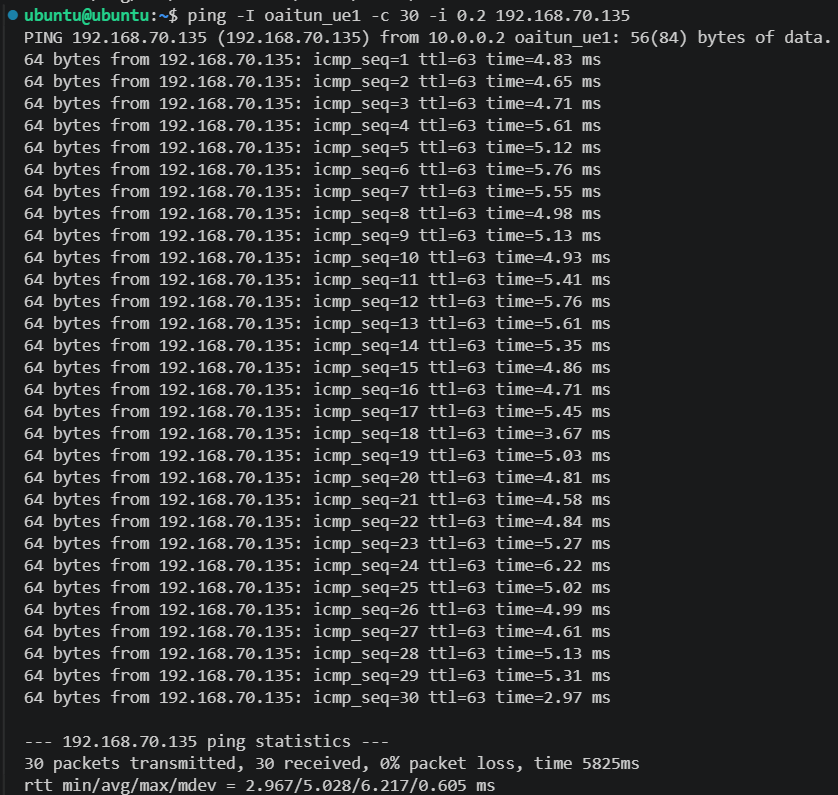

| Measurement | Observed Value |
| --- | --- |
| Packets transmitted / received | 30 / 30 |
| Packet loss (%) | 0 |
| Min / Avg / Max / mdev RTT (ms) | 2.967 / 5.028 / 6.217 / 0.605 |

PCAP summary (`tshark -z io,phs`):

| Item | Value |
| --- | --- |
| File | `lab4-f1-complete.pcap` (33 KB) |
| Total frames | 232 |
| SCTP frames (F1-C) | 145, of which 24 carry F1AP. The rest are SACK and HEARTBEAT/HEARTBEAT_ACK |
| GTP-U frames (F1-U) | 87 |
| Capture duration | ~905 s (00:46:27 → 01:01:32) |


## Task 4 — Analyze F1-C (F1AP / SCTP)

**SCTP association**

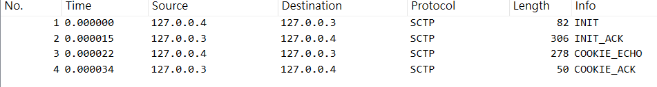

| No. | Source → Destination | Message |
| ---: | --- | --- |
| 1 | 127.0.0.4 → 127.0.0.3 | SCTP INIT |
| 2 | 127.0.0.3 → 127.0.0.4 | SCTP INIT_ACK |
| 3 | 127.0.0.4 → 127.0.0.3 | SCTP COOKIE_ECHO |
| 4 | 127.0.0.3 → 127.0.0.4 | SCTP COOKIE_ACK |

The SCTP ports were DU `55778` ↔ CU `38472`. Port 38472 is the standard F1-C SCTP port.

**F1 Setup**

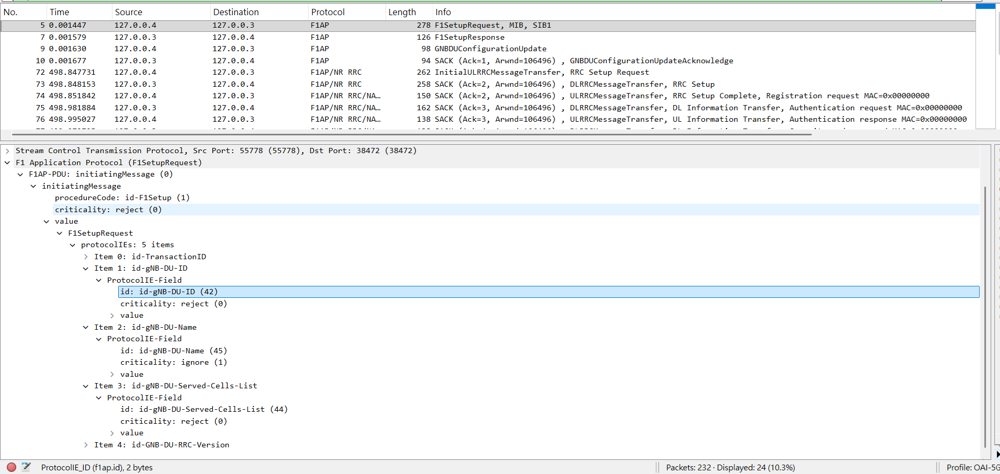

| No. | Time (s) | Source → Destination | F1AP message |
| ---: | ---: | --- | --- |
| 5 | 0.001447 | 127.0.0.4 → 127.0.0.3 | F1SetupRequest (carries MIB, SIB1) |
| 7 | 0.001579 | 127.0.0.3 → 127.0.0.4 | F1SetupResponse |
| 9 | 0.001630 | 127.0.0.4 → 127.0.0.3 | GNBDUConfigurationUpdate |
| 10 | 0.001677 | 127.0.0.3 → 127.0.0.4 | GNBDUConfigurationUpdateAcknowledge |

The F1 Setup Request (frame 5) contained the gNB-DU ID (`3584`), the gNB-DU name (`du-rfsim`), and the served-cell list (NR Cell ID `12345678`, PCI `0`) together with the DU-generated MIB and SIB1. The whole F1 Setup procedure took about 0.13 ms on loopback.

**UE-associated F1AP messages**

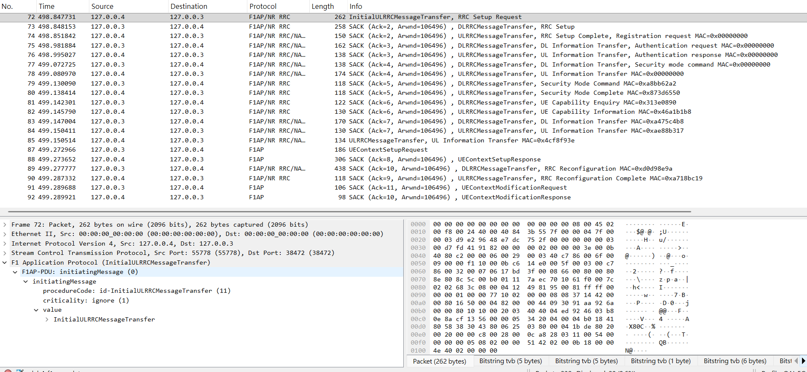

| No. | Time (s) | Direction | F1AP message | Carried RRC / NAS content |
| ---: | ---: | --- | --- | --- |
| 72 | 498.847731 | DU → CU | InitialULRRCMessageTransfer | RRC Setup Request |
| 73 | 498.848153 | CU → DU | DLRRCMessageTransfer | RRC Setup |
| 74 | 498.851842 | DU → CU | ULRRCMessageTransfer | RRC Setup Complete + NAS **Registration request** |
| 75 | 498.981884 | CU → DU | DLRRCMessageTransfer | DL Information Transfer + NAS Authentication request |
| 76 | 498.995027 | DU → CU | ULRRCMessageTransfer | UL Information Transfer + NAS Authentication response |
| 77 | 499.072725 | CU → DU | DLRRCMessageTransfer | DL Information Transfer + NAS Security mode command |
| 78 | 499.080970 | DU → CU | ULRRCMessageTransfer | UL Information Transfer (NAS, security-protected) |
| 79 | 499.130090 | CU → DU | DLRRCMessageTransfer | RRC Security Mode Command |
| 80 | 499.138414 | DU → CU | ULRRCMessageTransfer | RRC Security Mode Complete |
| 81 | 499.142301 | CU → DU | DLRRCMessageTransfer | UE Capability Enquiry |
| 82 | 499.145790 | DU → CU | ULRRCMessageTransfer | UE Capability Information |
| 83 | 499.147004 | CU → DU | DLRRCMessageTransfer | DL Information Transfer (NAS, ciphered) |
| 84 | 499.150411 | DU → CU | ULRRCMessageTransfer | UL Information Transfer (NAS, ciphered) |
| 85 | 499.150514 | DU → CU | ULRRCMessageTransfer | UL Information Transfer (NAS, ciphered) |
| 87 | 499.272966 | CU → DU | **UEContextSetupRequest** | DRB 1 to be set up, UL F1-U TEID |
| 88 | 499.273652 | DU → CU | **UEContextSetupResponse** | DU-to-CU RRC info, DL F1-U TEID |
| 89 | 499.277777 | CU → DU | DLRRCMessageTransfer | **RRC Reconfiguration** (+ NAS) |
| 90 | 499.287332 | DU → CU | ULRRCMessageTransfer | RRC Reconfiguration Complete |
| 91 | 499.289688 | CU → DU | UEContextModificationRequest | — |
| 92 | 499.289921 | DU → CU | UEContextModificationResponse | — |

Wireshark could not decode the NAS messages in frames 83–85 and 89 because they are ciphered. From where they fall in the sequence (after NAS Security Mode, before and around PDU session resource setup), they correspond to the Registration Accept, Registration Complete, the PDU Session Establishment Request, and the PDU Session Establishment Accept carried inside the RRC Reconfiguration. The UE log confirms both `Registration Accept` and `PDU Session Establishment Accept, UE IPv4: 10.0.0.2`.

**NAS Registration Request inside F1AP (frame 74)**

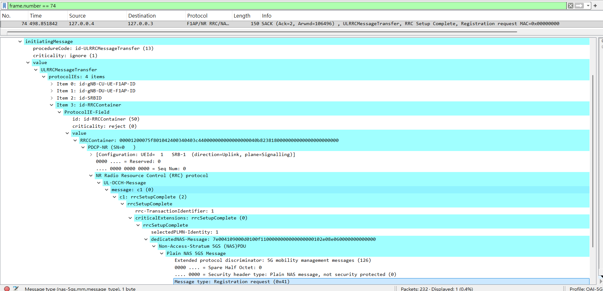

```text
IPv4 127.0.0.4 → 127.0.0.3
 └ SCTP (55778 → 38472)
    └ F1AP ULRRCMessageTransfer  (procedureCode 13, IE id-RRCContainer, SRB1)
       └ PDCP-NR  (SRB-1, Uplink, SN = 0, MAC = 0x00000000)
          └ NR RRC  UL-DCCH-Message: rrcSetupComplete
             └ dedicatedNAS-Message
                └ 5GS NAS: Registration request (0x41)
                   Security header type: Plain NAS message, not security protected
```

**F1-U tunnel negotiation in UE Context Setup (frame 87)**

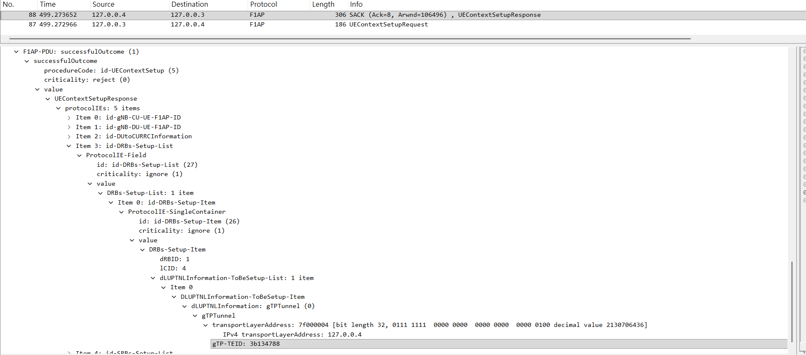

| Frame | Message | IE | Transport address | gTP-TEID |
| ---: | --- | --- | --- | --- |
| 87 | UEContextSetupRequest (CU → DU) | DRBs-ToBeSetup → `uLUPTNLInformation` (DRB 1, QFI 1, `rlc-am`) | 127.0.0.3 | `0x79d6a92b` |
| 88 | UEContextSetupResponse (DU → CU) | DRBs-Setup → `dLUPTNLInformation` (DRB 1) | 127.0.0.4 | `0x3b134788` |

**Questions:**

1. Which node initiates F1 Setup, and which acknowledges it?

   **Ans：** The **gNB-DU** initiates it. In frame 5, the DU (127.0.0.4) sent the F1 Setup Request to the CU (127.0.0.3), with its DU ID, name, served cell, MIB, and SIB1. The **gNB-CU** acknowledged it with the F1 Setup Response in frame 7, which activated the cell. The logs agree: the CU printed `Received F1 Setup Request from gNB_DU 3584 (du-rfsim)` and `sending F1 Setup Response`, and the DU printed `received F1 Setup Response from CU cu-rfsim`.

2. Explain the difference between SCTP association establishment and F1 Setup.

   **Ans：** The SCTP association (frames 1–4: INIT, INIT_ACK, COOKIE_ECHO, COOKIE_ACK) is a **transport-layer** handshake. It only creates a reliable, message-oriented connection between 127.0.0.4:55778 and 127.0.0.3:38472 and knows nothing about cells or 5G. F1 Setup (frames 5 and 7) is an **application-layer F1AP procedure** that runs over this association. In it, the DU and CU exchange their identities, the DU reports its served cells and system information, and the CU accepts the DU and activates the cell. The SCTP association must exist first, but having one does not mean the CU has accepted the DU.

3. How can a NAS Registration Request be transported over F1-C?

   **Ans：** The DU does not process NAS, or even RRC. In frame 74, the UE's Registration Request travels as the `dedicatedNAS-Message` inside an RRC `rrcSetupComplete` message. That RRC message sits in a PDCP-NR PDU on SRB1. The DU puts this PDU into the `RRCContainer` IE of an F1AP **ULRRCMessageTransfer** and sends it to the CU over SCTP. The CU's PDCP/RRC extracts the NAS PDU and forwards it to the AMF over NGAP (N2). Downlink NAS messages take the reverse path in **DLRRCMessageTransfer**, for example the Authentication request in frame 75 and the Security mode command in frame 77. Frame 74's NAS message was marked `Plain NAS message, not security protected`, because NAS security had not been set up yet.

4. What is the role of UE Context Setup?

   **Ans：** RRC and PDCP are in the CU, but the radio resources are in the DU. UE Context Setup is how the CU asks the DU to create a UE-specific context with the resources the UE needs. In frame 87, the CU asked the DU to set up SRB2 and **DRB 1** (QFI 1, RLC AM) on SpCell 12345678. It also gave the UL F1-U tunnel endpoint (127.0.0.3, TEID `0x79d6a92b`). In frame 88, the DU replied with the CellGroupConfig it generated (RLC/MAC/PHY configuration, which the CU puts into the RRC Reconfiguration) and the DL F1-U endpoint (127.0.0.4, TEID `0x3b134788`). Only after this could the CU send the RRC Reconfiguration (frame 89) and open the F1-U tunnel that carried the pings.

5. Does F1 Setup alone prove successful UE Registration? Explain.

   **Ans：** No. F1 Setup happened at t ≈ 0.0015 s, before any UE existed. It only shows that the DU and CU can talk to each other and that the cell is active. Registration came almost 500 s later (frames 72–85, after I started the nrUE). It needed several more steps: UE synchronization with the DU, RRC Setup, NAS authentication through the AMF/AUSF/UDM, and NAS and RRC security. Registration itself is only confirmed by the UE log line `Received Registration Accept`. A DU can complete F1 Setup successfully while every UE still fails registration, for example because of a wrong IMSI as in Lab 3 Task 5.


## Task 5 — Analyze F1-U (GTP-U / UDP)

**Uplink T-PDU (DU → CU), frame 133**

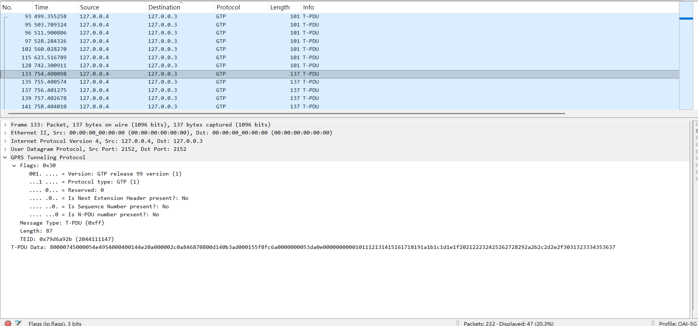

**Downlink T-PDU (CU → DU), frame 134**

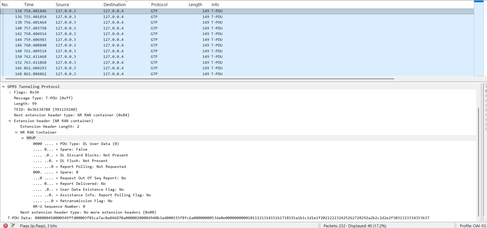

| Field | UL (frame 133) | DL (frame 134) |
| --- | --- | --- |
| Outer IP | 127.0.0.4 → 127.0.0.3 | 127.0.0.3 → 127.0.0.4 |
| UDP ports | 2152 → 2152 | 2152 → 2152 |
| GTP flags | `0x30` (no extension header) | `0x34` (extension header present) |
| Message type | T-PDU (`0xff`) | T-PDU (`0xff`) |
| TEID | `0x79d6a92b` (2044111147) | `0x3b134788` (991119240) |
| Extension header | — | NR RAN Container (`0x84`): NR-U PDU Type 0 = DL User Data, NR-U SN 0 |
| PDCP header | `80 00 07` (D/C = data, 18-bit SN = 7) | `80 00 00` (D/C = data, SN = 0) |
| Inner IP | 10.0.0.2 → 192.168.70.135 | 192.168.70.135 → 10.0.0.2 |
| Inner payload | ICMP Echo Request (type 8) | ICMP Echo Reply (type 0) |

Decoding the UL T-PDU data (frame 133):

```text
80 00 07                 PDCP data PDU header, 18-bit SN = 7
45 00 00 54 ...          IPv4, total length 84
... 40 01 ...            TTL 64, protocol 1 (ICMP)
0a 00 00 02              src 10.0.0.2       (UE)
c0 a8 46 87              dst 192.168.70.135 (external DN)
08 00 ...                ICMP Echo Request
10 11 12 ... 37          default ping padding
```

Wireshark shows the payload only as `T-PDU Data` and does not decode the inner ICMP. This is because F1-U carries **PDCP PDUs**, not raw IP packets, and the 3-byte PDCP header comes before the IP header. On the N3 interface, by contrast, the GTP-U payload is the bare IP packet.

Packet counts:

| Direction | Filter | Packets | TEID | Content |
| --- | --- | ---: | --- | --- |
| UL (DU → CU) | `gtp && ip.src == 127.0.0.4 && ip.dst == 127.0.0.3` | 47 | `0x79d6a92b` | 40 ICMP Echo Requests + 7 IPv6 Router Solicitations |
| DL (CU → DU) | `gtp && ip.src == 127.0.0.3 && ip.dst == 127.0.0.4` | 40 | `0x3b134788` | 40 ICMP Echo Replies |

The counts are **not equal**. The 40 Echo Request/Reply pairs match the 10 + 30 pings exactly. The 7 extra UL packets (frames 93–128, 101 bytes each) are ICMPv6 Router Solicitations (type 133, `fe80::…` → `ff02::2`), which the UE's `oaitun_ue1` interface sent by itself. Their intervals of about 4, 8, 16, 32, 63 and 119 s follow the standard exponential backoff. The DN never answers them, so they have no DL counterpart. These RS packets used PDCP SN 0–6, which is why the first ping (frame 133) has PDCP SN 7.

Timing inside the capture: for each of the 40 pings, the time from the UL T-PDU leaving the DU to the DL T-PDU returning to the DU averaged **1.132 ms** (min 0.189 ms, max 1.775 ms). This interval covers CU processing, N3, the UPF, and the DN. Since the end-to-end ping RTT was about 4.9–5.0 ms, roughly 3.8 ms of each ping was spent on the radio side (UE ↔ DU: MAC scheduling, TDD slot timing, PHY processing). The F1 hop itself on loopback adds almost nothing.

**Questions:**

1. Which transport protocol carries F1-U?

   **Ans：** F1-U uses **GTP-U over UDP over IP**. In my capture, every F1-U packet was UDP 2152 → 2152 between 127.0.0.4 and 127.0.0.3, with GTP message type T-PDU (`0xff`). The DU and CU logs also show the GTP-U sockets: `Initializing UDP for local address 127.0.0.4 with port 2152` (DU) and `... 127.0.0.3 with port 2152` (CU).

2. What does a GTP-U **TEID** identify?

   **Ans：** The TEID (Tunnel Endpoint Identifier) identifies a specific tunnel at the **receiving** endpoint, so the receiver knows which UE and which bearer a packet belongs to. Many UEs and DRBs share the same IP address and port 2152, and the TEID is what tells them apart. The receiver allocates its TEID and signals it to the sender through F1AP. In my capture, the CU chose `0x79d6a92b` for the UL tunnel of DRB 1 (frame 87, UEContextSetupRequest), and every DU → CU T-PDU used it. The DU chose `0x3b134788` for DL (frame 88, UEContextSetupResponse), and every CU → DU T-PDU used it. Each direction therefore has its own TEID.

3. Which direction is `127.0.0.4 → 127.0.0.3` in this setup?

   **Ans：** It is the **uplink**: from the gNB-DU (127.0.0.4) to the gNB-CU (127.0.0.3). The DU's RLC receives the UE's data over the air and forwards the PDCP PDUs to the CU's PDCP. The decoded payload confirms this: the inner packets go from 10.0.0.2 (UE) to 192.168.70.135 and are ICMP Echo Requests. The reverse direction, 127.0.0.3 → 127.0.0.4, carried the Echo Replies (downlink).

4. How would you distinguish F1-U from N3 in a packet capture?

   **Ans：** Port number and protocol cannot tell them apart. Both are GTP-U on UDP 2152, and Wireshark labels both as `GTP`. In this setup, the CU even opens two GTP-U instances on port 2152: `192.168.70.129:2152` for N3 and `127.0.0.3:2152` for F1-U. To identify the interface:
   - **Endpoints:** F1-U runs between the DU and CU (127.0.0.4 ↔ 127.0.0.3). N3 runs between the CU's NG-U address (192.168.70.129) and the UPF on the `oai-cn5g` Docker network.
   - **Signaling source:** F1-U TEIDs are exchanged in F1AP UE Context Setup (frames 87–88). N3 TEIDs are exchanged in NGAP PDU Session Resource Setup and PFCP.
   - **Payload:** F1-U carries PDCP PDUs (a 3-byte PDCP header before the IP packet, and NR-U in DL). N3 carries the bare IP packet, usually with a PDU Session Container extension header (`0x85`) that holds the QFI.
   - **Capture point:** my capture was on `lo` and filtered on `host 127.0.0.3 and host 127.0.0.4`, so it contains only F1-U. N3 traffic would show up on the `oai-cn5g` bridge interface.

5. Why do F1-C and F1-U use different transport protocols?

   **Ans：** They have different requirements. **F1-C** carries signaling such as F1 Setup, UE Context Setup, and RRC messages. Losing or reordering any of these would break a procedure, so it uses **SCTP**, which gives reliable, ordered, message-oriented delivery, multi-streaming, and keep-alive (the capture contains SCTP SACKs and HEARTBEAT/HEARTBEAT_ACK). **F1-U** carries large volumes of user data where low latency and low overhead matter more than per-packet transport reliability. Retransmission is already handled by RLC AM and by higher layers such as TCP, and an occasional lost packet is acceptable. So it uses **UDP**, with GTP-U on top to multiplex UEs and bearers by TEID. The same pattern appears on the core side: N2 uses NGAP/SCTP and N3 uses GTP-U/UDP.


## Task 6 — Compare Monolithic and Split gNB

| Feature | Lab 3: Monolithic gNB | Lab 4: CU/DU Split |
| --- | --- | --- |
| Number of RAN processes | 1 (`nr-softmodem` as gNB) + nrUE | 2 (`nr-softmodem` as CU, `nr-softmodem` as DU) + nrUE |
| Location of RRC/PDCP | Inside the single gNB process | gNB-CU (127.0.0.3) |
| Location of RLC/MAC/PHY | Inside the single gNB process | gNB-DU (127.0.0.4) |
| F1-C interface present? | No (internal function calls) | Yes: F1AP over SCTP, 127.0.0.4:55778 ↔ 127.0.0.3:38472 |
| F1-U interface present? | No | Yes: GTP-U over UDP 2152, UL TEID `0x79d6a92b`, DL TEID `0x3b134788` |
| UE connected to the same 5GC? | Yes: OAI CN5G, AMF 192.168.70.132 | Yes: the same OAI CN5G, AMF 192.168.70.132 (via the CU) |
| End-to-end Ping works? | Yes: 10/10, 0% loss, avg 5.793 ms | Yes: 10/10, 0% loss, avg 4.876 ms; 30/30, 0% loss, avg 5.028 ms |

Splitting the gNB only redistributes the RAN protocol stack between two nodes: RRC/PDCP move to the CU, RLC/MAC/PHY stay in the DU, and the internal function calls between them are replaced by the standardized F1-C (F1AP/SCTP) and F1-U (GTP-U/UDP) interfaces. To the UE and the 5GC, the CU and DU together still look like one gNB. The UE sees the same kind of SSB, SIB1, and RRC procedures over the air, and the AMF sees one NG Setup from gNB ID 3584. The UE therefore still has to synchronize to the cell, which is now broadcast by the DU, so its frequency must match the DU's SSB at 3,450.72 MHz. It still has to complete RRC Setup, register and authenticate with the AMF through NAS, and establish a PDU session to get an IP address. My capture shows exactly this: the same RRC and NAS messages as in a monolithic gNB, just relayed through F1AP RRC containers. The split did not noticeably increase latency, because the F1 hop over loopback costs microseconds. The lower RTT compared with Lab 3 is more likely caused by the different DU configuration (for example `min_rxtxtime = 4` instead of 6) and run-to-run variation than by the split itself.