## Goal

In Lab 1, I observed UE registration with the 5GC and the establishment of data service. This lab moves the observation point earlier, to everything that happens **before** the UE talks to the Core network: cell search and synchronization, reading the broadcast system information (MIB/SIB1), the four-step contention-based Random Access (Msg1–Msg4), and the RRC Connection Setup that ends in `RRC_CONNECTED`.

I did not run OAI for this lab. I reconstructed the procedure from the three supplied files of the same successful OAI run (`Lab5-ue.log`, `Lab5-gnb.log`, `Lab5.pcap`). I used `grep` on the logs and Wireshark 4.6.8 on the PCAP. The PCAP is a gNB T-tracer capture exported as MAC-NR/MAC-LTE PDUs (5,135 frames: 2,320 MIB, 2,320 SIB1, plus the UE-specific MAC/RLC/PDCP/RRC traffic).

All frame numbers, line numbers, and values below come from these files.


## Task 1 — From Cell Search to Msg2 RAR

### Step 1: Cell Search and Initial Synchronization

```bash
grep -nE 'Starting cell search|Initial sync successful' lab5-artifacts/Lab5-ue.log
```

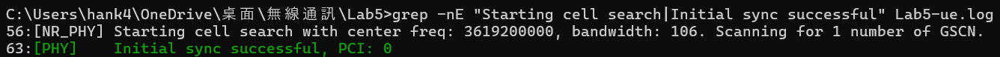

| Item | Value |
| --- | --- |
| `Starting cell search` | line 56: `center freq: 3619200000, bandwidth: 106. Scanning for 1 number of GSCN.` |
| `Initial sync successful` | line 63 |
| Synchronization succeeded? | **Yes** |
| PCI | **0** |

The lines between them show how sync was achieved: `Initial sync: pbch decoded sucessfully, ssb index 0` (line 58), `Cell Detected with GSCN: 0, SSB SC offset: 516 ... PSS Corr peak: 90 dB` (line 60), and `Measured Carrier Frequency offset 2 Hz` (line 62). Right after sync the RRC layer updates the serving cell: `BCCH update: phyCellID 0->0, arfcn_ssb 0->641280` (line 66), i.e. SSB at 3000 + 0.015 × (641280 − 600000) = 3619.20 MHz, which matches the `-C 3619200000` used to start the UE.

**Question:** After completing initial synchronization, what is the UE able to do?

**Ans：** Initial synchronization means the UE detected the PSS/SSS of an SSB, so it now knows the **Physical Cell ID (PCI 0)** and is aligned to the cell in **time** (symbol, slot, and frame boundary; `In synch, rx_offset 522240 samples`) and **frequency** (CFO of only 2 Hz). It also decoded the PBCH, so it knows the SSB index and SFN. With this, the UE can (1) demodulate the PBCH and read the **MIB**, (2) use the MIB's CORESET#0/SearchSpace#0 to monitor the PDCCH with SI-RNTI and decode **SIB1** (`SIB1 decoded`, line 71), and (3) measure the cell (RSRP) for cell selection. It is **not** connected yet. It is still in RRC_IDLE and has no dedicated resources or C-RNTI. Synchronization is only the precondition for reading system information and starting Random Access.


### Step 2: MIB and SIB1

Wireshark display filter: `nr-rrc`

**MIB — frame 2**

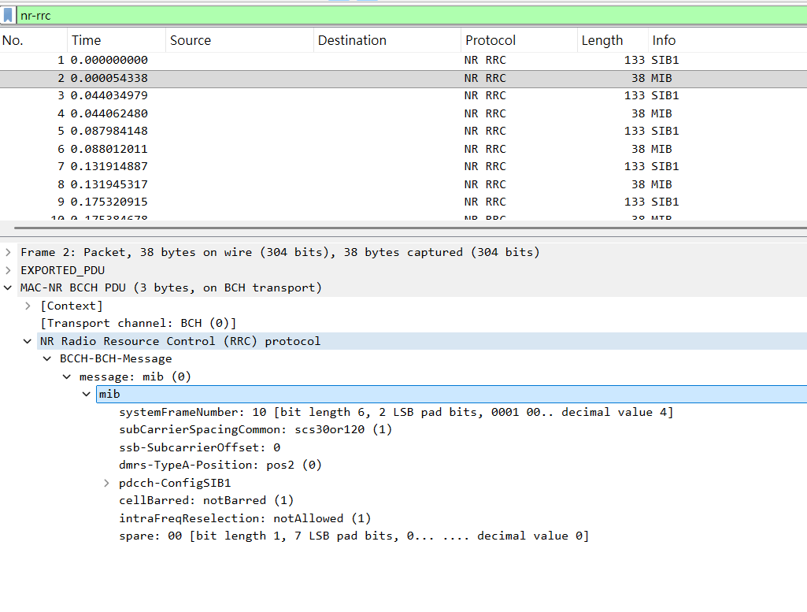

**SIB1 — frame 1**

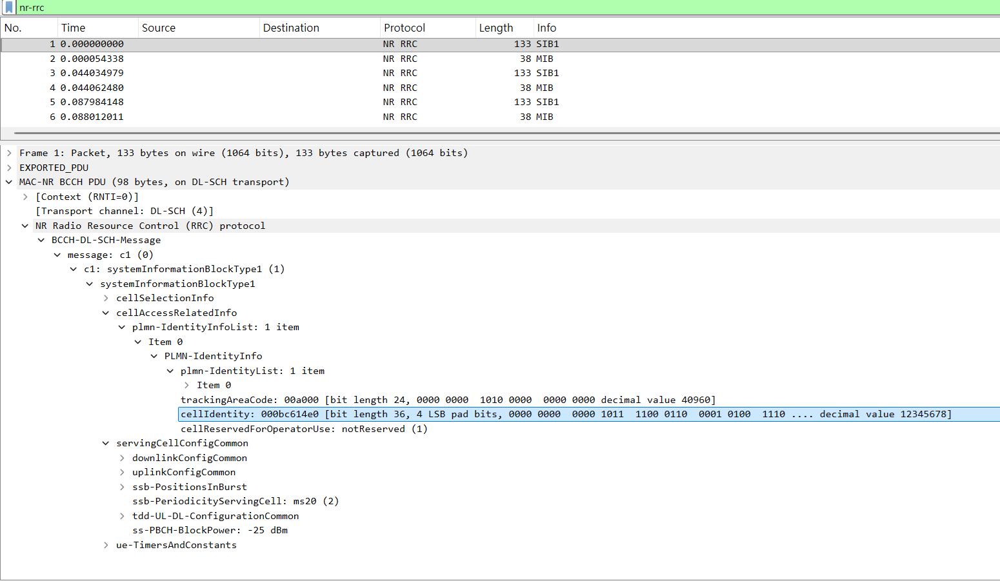

| Message | Frame number | Transport | Key fields |
| --- | ---: | --- | --- |
| MIB | **2** | `MAC-NR BCCH PDU (3 bytes, on BCH transport)`, NO-RNTI | `subCarrierSpacingCommon: scs30or120`, `ssb-SubcarrierOffset: 0`, `dmrs-TypeA-Position: pos2`, `pdcch-ConfigSIB1: controlResourceSetZero 11, searchSpaceZero 0`, `cellBarred: notBarred` |
| SIB1 | **1** | `MAC-NR BCCH PDU (98 bytes, on DL-SCH transport)`, SI-RNTI | PLMN `208/95`, TAC `0x00a000`, cellIdentity `12345678`, band `n78`, `carrierBandwidth: 106`, SCS 30 kHz, TDD `ms5` (7 DL slots + 6 DL symbols, 2 UL slots + 4 UL symbols), `prach-ConfigurationIndex: 98`, `ra-ResponseWindow: sl20`, `ra-ContentionResolutionTimer: sf64`, `prach-RootSequenceIndex: l139 = 1`, `preambleReceivedTargetPower: -104 dBm`, `t300: ms400` |

Both messages repeat throughout the capture (2,320 times each). For example, frames 485–488 are SIB1, MIB, SIB1, MIB just before the PRACH in frame 489.

**Question:** Briefly explain the purpose of MIB and SIB1 for UE access.

**Ans：**
- The **MIB** is the minimum information carried on the PBCH inside the SSB, and it is the only thing the UE can read right after sync. It gives the SFN, the common subcarrier spacing (30 kHz here), the SSB subcarrier offset, the DMRS position, the cell-barred flag, and, most importantly, `pdcch-ConfigSIB1` (CORESET#0 = 11, SearchSpace#0 = 0). Without these the UE would not know where to look for the PDCCH that schedules SIB1.
- **SIB1** carries the cell access and common configuration. With `cellAccessRelatedInfo` (PLMN 208/95, TAC, cell ID) and `cellSelectionInfo` (`q-RxLevMin -130 dBm`), the UE decides whether it may camp on this cell. `servingCellConfigCommon` describes the initial DL/UL BWP, the TDD pattern, and `rach-ConfigCommon`: the PRACH configuration index, root sequence, target power, RAR window, and contention resolution timer. The UE needs these to send Msg1 and to know when to expect Msg2. SIB1 also gives the timers for RRC setup (`t300 = 400 ms`).

In short, the MIB tells the UE how to find SIB1, and SIB1 tells the UE whether it may access the cell and how to perform Random Access.


### Step 3: Msg1 PRACH

```bash
grep -nE 'PRACH' lab5-artifacts/Lab5-ue.log
```

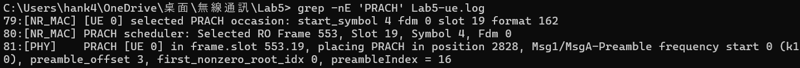

| Line | Log content |
| ---: | --- |
| 79 | `[NR_MAC] [UE 0] selected PRACH occasion: start_symbol 4 fdm 0 slot 19 format 162` |
| 80 | `[NR_MAC] PRACH scheduler: Selected RO Frame 553, Slot 19, Symbol 4, Fdm 0` |
| **81** | `[PHY] PRACH [UE 0] in frame.slot 553.19, placing PRACH in position 2828, Msg1/MsgA-Preamble frequency start 0 (k1 0), preamble_offset 3, first_nonzero_root_idx 0, preambleIndex = 16` |

```text
Msg1 log line  = 81
frame.slot     = 553.19
preambleIndex  = 16
```

Wireshark: cleared filter → `Ctrl + F` → **Packet details** → `RACH Preamble chosen`

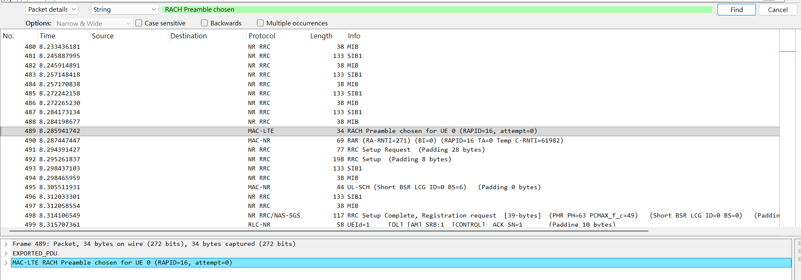

```text
Frame 489: MAC-LTE RACH Preamble chosen for UE 0 (RAPID=16, attempt=0)
RAPID = 16
```

The gNB log confirms the same event from the receiver side: `[RAPROC] 553.19 Initiating RA procedure with preamble 16, energy 60.5 dB` (gNB log line 186).

**Questions:**

1. Which Random Access message is this PRACH transmission?

   **Ans：** It is **Msg1**, the Random Access preamble, sent by the UE on the PRACH in the uplink. It is the first message of the four-step contention-based Random Access (CBRA). The UE log line 78 shows `Initialization of 4-Step CBRA procedure` right before it. At this point the UE has no RNTI and no uplink grant, so the preamble is the only thing it can send. It tells the gNB that a UE wants access, and it lets the gNB estimate the UE's uplink timing.

2. At which `frame.slot` and with which `preambleIndex` does the UE log show transmission?

   **Ans：** At `frame.slot 553.19` (frame 553, slot 19, start symbol 4, FDM 0) with `preambleIndex = 16` (UE log line 81). Slot 19 is one of the UL slots of the 5 ms TDD pattern configured in SIB1, and the occasion matches `prach-ConfigurationIndex 98`.

3. Does the Wireshark `RAPID` match the UE-log `preambleIndex`? What does this show?

   **Ans：** Yes. Wireshark frame 489 shows `RAPID = 16`, which equals the UE's `preambleIndex = 16`. Since the PCAP was recorded by the gNB tracer, this shows that the gNB actually **detected** the preamble the UE sent, so Msg1 crossed the air interface successfully. The time context in the MAC-LTE tracer event (SFN 554, subframe 3) is the time the gNB reported the event, in LTE-style subframes, so it is not directly comparable with the NR `frame.slot`. The RAPID is the value that links the two sides, and the gNB log line 186 gives the exact same `553.19`.


### Step 4: Msg2 RAR

Wireshark: cleared filter → `Ctrl + F` → **Packet details** → `RAR`

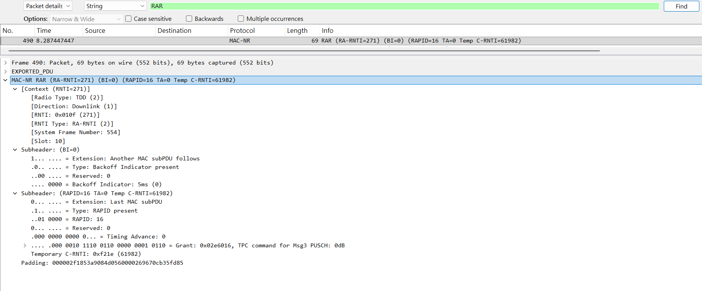

```text
Frame number      = 490
RAPID             = 16
Temporary C-RNTI  = 0xf21e (61982)
```

| Field in frame 490 | Value |
| --- | --- |
| Info | `MAC-NR RAR (RA-RNTI=271) (BI=0) (RAPID=16 TA=0 Temp C-RNTI=61982)` |
| Context | Downlink, `RNTI: 0x010f (271)`, `RNTI Type: RA-RNTI`, SFN 554, slot 10 |
| Subheader 1 | Backoff Indicator: 5 ms (0) |
| Subheader 2 | `RAPID: 16` |
| Timing Advance | 0 (RFsimulator, distance 0 m) |
| UL Grant | `0x02e6016`: Msg3 PUSCH freq. allocation 742, time allocation 0, MCS 1, TPC 0 dB, no hopping, no CSI request |
| Temporary C-RNTI | **0xf21e (61982)** |

The UE log shows the receiving side: `RAR-Msg2 decoded` (line 82), `[RA-RNTI 010f] Got RAPID RAR subPDU` (line 84), and `[554.10] Found RAR with the intended RAPID 16` (line 85). The gNB log shows `UE RA-RNTI 010f TC-RNTI f21e: initiating RA procedure for RAPID 16` (line 187) and `554.10 Generating RA-Msg2 DCI, RA RNTI 0x10f ... preamble_index(RAPID) 16` (line 190).

Msg2 is the gNB's response to Msg1. The RAR is addressed with the **RA-RNTI** (0x010f), which is derived from the time/frequency position of the PRACH occasion, and the **RAPID** inside it (16) tells the UE that this RAR answers its own preamble. The RAR gives the UE three things it needs for the next step: a **Timing Advance** to align its uplink, an **uplink grant** for Msg3, and a **Temporary C-RNTI** (0xf21e) to use until contention is resolved.


## Task 2 — Complete Random Access and RRC Connection Setup

### Step 1: RRCSetupRequest (Msg3)

Filter: `nr-rrc.rrcSetupRequest_element`

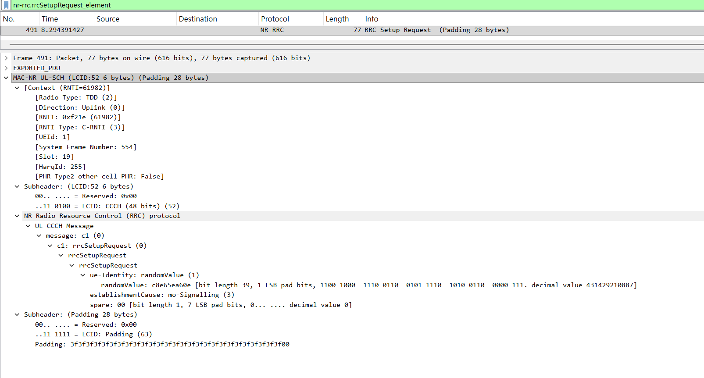

```text
Frame number   = 491
Context RNTI   = 0xf21e (61982)
```

```text
MAC-NR UL-SCH (LCID:52 6 bytes) (Padding 28 bytes)
 [Context (RNTI=61982)]  Uplink, RNTI Type: C-RNTI, SFN 554, Slot 19
 Subheader: LCID: CCCH (48 bits) (52)
  └ NR RRC  UL-CCCH-Message → c1: rrcSetupRequest
     ├ ue-Identity: randomValue = c8e65ea60e (39 bits)
     └ establishmentCause: mo-Signalling (3)
```

Msg3 was sent at 554.19, exactly the slot the gNB scheduled (`Msg3 scheduled at 554.19`, gNB log line 189), using the grant from the RAR. The gNB received it correctly: `554.19 PUSCH with TC_RNTI 0xf21e received correctly` and `Received SDU for CCCH length 6 for UE f21e` (gNB log lines 191–192). The UE log also shows `[554.19] RA-Msg3 transmitted` (line 86).

**Questions:**

1. Does the `Context RNTI` match the `Temporary C-RNTI` in the Task 1 / Step 4 RAR? What does this show?

   **Ans：** Yes. The Context RNTI of frame 491 is `0xf21e (61982)`, the same as the Temporary C-RNTI in the RAR (frame 490). This shows that the UE used the grant and identity it received in Msg2: it was scheduled with TC-RNTI 0xf21e and sent its Msg3 on that PUSCH. In other words, Msg3 continues the same Random Access procedure (RAPID 16 → TC-RNTI 0xf21e → Msg3). However, the TC-RNTI is only temporary. If another UE had sent the same preamble 16 in the same occasion, both would have received the same RAR and both would send Msg3 with 0xf21e, so the RNTI alone cannot yet prove *which* UE this is.

2. Can you claim that the RRC connection has been established after seeing only `RRCSetupRequest`? Why or why not?

   **Ans：** No. `RRCSetupRequest` is only the UE's **request**. It travels on SRB0 (CCCH), which has no security and no RLC AM, and it identifies the UE only by a 39-bit random value. At this point (a) contention is not resolved, so the gNB may have decoded a different UE's Msg3, (b) the gNB has not accepted the request; it could reply with `RRCReject` or not reply at all and let T300 expire, and (c) SRB1 does not exist yet. The connection is established only after the UE receives `RRCSetup` with a matching Contention Resolution Identity, applies the configuration, and enters `RRC_CONNECTED`, which it then confirms with `RRCSetupComplete`.


### Step 2: RRCSetup (Msg4)

Filter: `nr-rrc.rrcSetup_element`

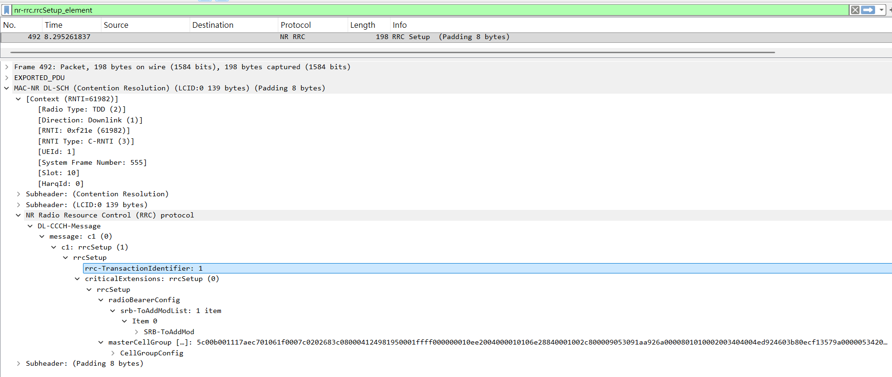

```text
Frame number              = 492
Context RNTI              = 0xf21e (61982)
rrc-TransactionIdentifier = 1
Contention Resolution     = present (UE Contention Resolution Identity: 1c8e65ea60e6)
```

```text
MAC-NR DL-SCH (Contention Resolution) (LCID:0 139 bytes) (Padding 8 bytes)
 [Context (RNTI=61982)]  Downlink, RNTI Type: C-RNTI, SFN 555, Slot 10
 Subheader: LCID: UE Contention Resolution Identity (62)
    UE Contention Resolution Identity: 1c8e65ea60e6
 Subheader: LCID: CCCH (0), SDU Length: 139
  └ NR RRC  DL-CCCH-Message → c1: rrcSetup
     ├ rrc-TransactionIdentifier: 1
     └ criticalExtensions: rrcSetup
        ├ radioBearerConfig: srb-ToAddModList → srb-Identity 1
        └ masterCellGroup → CellGroupConfig
           (RLC AM for SRB1, MAC config: SR/BSR/TAG/PHR,
            spCellConfigDedicated: PDCCH/PDSCH/PUCCH/PUSCH/SRS ...)
```

The `UE Contention Resolution Identity` (`1c 8e 65 ea 60 e6`) is exactly the 48-bit CCCH SDU the UE sent in Msg3: the UL-CCCH-Message header bits followed by the random value `c8e65ea60e` and the establishment cause. This is the "length 6" CCCH SDU in gNB log line 192.

**Questions:**

1. Which message is this in four-step Random Access?

   **Ans：** It is **Msg4**, the contention resolution message: the downlink message that the gNB sends after decoding Msg3, on PDSCH to TC-RNTI 0xf21e. The gNB log shows `Activating scheduling Msg4 for TC_RNTI 0xf21e` (line 196) and `UE f21e Generate Msg4 ... payload 157 bytes` (line 202). The UE log shows the result: `[555.10][RAPROC] 4-Step RA procedure succeeded. CBRA: Contention Resolution is successful.` (line 87).

2. What does it mean that `Contention Resolution` and `RRCSetup` appear in the same downlink message?

   **Ans：** The single MAC PDU in frame 492 does two jobs at once:
   - The **MAC CE "UE Contention Resolution Identity"** finishes the Random Access. The UE compares it with the CCCH SDU it sent in Msg3. They match (`1c8e65ea60e6`), so the UE knows that the gNB decoded *its own* Msg3 and that it won any possible contention. The TC-RNTI 0xf21e is then promoted to its **C-RNTI**. A UE whose identity did not match would discard the PDU and restart Random Access.
   - The **RRCSetup on DL-CCCH (SRB0)** is the RRC answer to the `RRCSetupRequest`. It creates SRB1 and gives the full `masterCellGroup` configuration (RLC/MAC/PHY).

   Putting them together means that contention resolution and RRC acceptance happen in the same step. As soon as the UE confirms it is the right UE, it already has the configuration it needs to enter RRC_CONNECTED. This saves a round trip and ensures that the RRC configuration is applied only by the UE that won contention. The UE log shows this order: RA succeeded (line 87) → `Received NR_RRCSetup` (line 88) → `Added srb 1` (line 89) → `State = NR_RRC_CONNECTED` (line 90).


### Step 3: RRCSetupComplete

Filter: `nr-rrc.rrcSetupComplete_element`

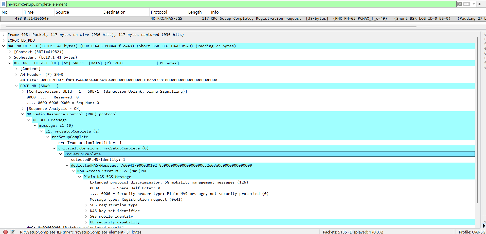

```text
Frame number              = 498
Context RNTI              = 0xf21e (61982)
rrc-TransactionIdentifier = 1
```

```text
MAC-NR UL-SCH (LCID:1 41 bytes) (PHR PH=63 PCMAX_f_c=49) (Short BSR LCG ID=0 BS=0) (Padding 27 bytes)
 [Context (RNTI=61982)]  Uplink, RNTI Type: C-RNTI, SFN 557, Slot 17
 └ RLC-NR  UEId=1 [UL] [AM] SRB:1 [DATA] (P) SN=0
    └ PDCP-NR (SN=0)  SRB-1, Uplink, Signalling
       └ NR Radio Resource Control (RRC) protocol
          └ UL-DCCH-Message → message: c1 → rrcSetupComplete
             ├ rrc-TransactionIdentifier: 1
             ├ selectedPLMN-Identity: 1
             └ dedicatedNAS-Message → 5GS NAS: Registration request (0x41)
                  initial registration, SUCI (MCC 208, MNC 95, MSIN 0000000036),
                  Plain NAS message, not security protected
```

This is the first message on **SRB1**. Unlike Msg3, it uses LCID 1, RLC AM (SN 0), and PDCP (SN 0), so the SRB1 configured by `RRCSetup` is now in use. The gNB log confirms it: `Received RRCSetupComplete (RRC_CONNECTED reached)` (gNB log line 205).

**Questions:**

1. Does the `Context RNTI` still match the `Temporary C-RNTI` in the RAR?

   **Ans：** Yes. Frame 498 is still sent with RNTI `0xf21e (61982)`, the same value given as Temporary C-RNTI in the RAR (frame 490) and used in Msg3 (frame 491) and Msg4 (frame 492). After successful contention resolution, the Temporary C-RNTI becomes the UE's **C-RNTI**. The UE and gNB logs from this point on simply call it `RNTI 0xf21e`, and the gNB log line 204 shows `Adding new UE context with RNTI 0xf21e`. The same RNTI is used for the rest of the connection (for example, Security Mode and UE Capability messages) until it is removed at the end (`Remove NR rnti 0xf21e`, gNB log line 458).

2. Does the `rrc-TransactionIdentifier` match the `RRCSetup` in Step 2? What is the purpose of this comparison?

   **Ans：** Yes. Both `RRCSetup` (frame 492) and `RRCSetupComplete` (frame 498) carry `rrc-TransactionIdentifier = 1`. The transaction identifier pairs an RRC response with the request that caused it. By copying the value from `RRCSetup`, the UE tells the gNB that this `RRCSetupComplete` answers *that specific* `RRCSetup`, and not an older or parallel RRC procedure. The matching ID, together with the unchanged RNTI, shows that frames 490 → 491 → 492 → 498 are one consistent procedure for the same UE, and that the RRC Connection Setup procedure completed successfully.


### Step 4: Final Random Access and RRC Connection Result

```bash
grep -nE '4-Step RA procedure succeeded|Received NR_RRCSetup|RRCSetupComplete|State = NR_RRC_CONNECTED' \
  lab5-artifacts/Lab5-ue.log
```

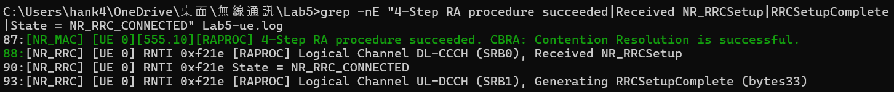

```text
4-Step RA procedure succeeded: line 87
Received NR_RRCSetup:          line 88
State = NR_RRC_CONNECTED:      line 90
Generating RRCSetupComplete:   line 93
```

| Line | Log content |
| ---: | --- |
| 87 | `[NR_MAC] [UE 0][555.10][RAPROC] 4-Step RA procedure succeeded. CBRA: Contention Resolution is successful.` |
| 88 | `[NR_RRC] [UE 0] RNTI 0xf21e [RAPROC] Logical Channel DL-CCCH (SRB0), Received NR_RRCSetup` |
| 90 | `[NR_RRC] [UE 0] RNTI 0xf21e State = NR_RRC_CONNECTED` |
| 93 | `[NR_RRC] [UE 0] RNTI 0xf21e [RAPROC] Logical Channel UL-DCCH (SRB1), Generating RRCSetupComplete (bytes33)` |

Timeline of the whole access procedure (from the UE log `frame.slot` and the PCAP):

| Event | frame.slot | PCAP frame | Wireshark time (s) |
| --- | --- | ---: | ---: |
| Msg1 PRACH (preamble 16) | 553.19 | 489 | 8.285942 |
| Msg2 RAR (RAPID 16, TC-RNTI 0xf21e) | 554.10 | 490 | 8.287447 |
| Msg3 RRCSetupRequest | 554.19 | 491 | 8.294391 |
| Msg4 Contention Resolution + RRCSetup | 555.10 | 492 | 8.295262 |
| RRCSetupComplete + Registration Request | 557.17 | 498 | 8.314107 |

From Msg1 to RRCSetupComplete took about 4 radio frames (≈ 40 ms of air time). In the PCAP, the frames are about 28 ms apart.

**Questions:**

1. In log order, what are the three events from successful Random Access to generating `RRCSetupComplete`?

   **Ans：**
   1. **Line 88, `Received NR_RRCSetup`:** right after the RA success at line 87, the UE's RRC receives the RRCSetup that arrived in the same Msg4 on DL-CCCH (SRB0).
   2. **Line 90, `State = NR_RRC_CONNECTED`:** the UE applies the configuration (line 89 `Added srb 1 to UE 0`) and changes its RRC state from IDLE to CONNECTED.
   3. **Line 93, `Generating RRCSetupComplete`:** NAS is told that the connection is up (line 91 `Received NR_NAS_CONN_ESTABLISH_IND`, line 92 `Generate Initial NAS Message: Registration Request`), and the UE builds `RRCSetupComplete` on UL-DCCH (SRB1) with the Registration Request inside.

   So the order is: Random Access success → RRCSetup received → RRC_CONNECTED → RRCSetupComplete generated.

2. What do `4-Step RA procedure succeeded` and `State = NR_RRC_CONNECTED` each prove?

   **Ans：**
   - `4-Step RA procedure succeeded. CBRA: Contention Resolution is successful.` proves a **MAC-layer** result. Msg1–Msg4 completed, the Contention Resolution Identity in Msg4 matched the UE's Msg3, and the UE is now uplink-synchronized (TA applied) with a valid **C-RNTI** (0xf21e). It says nothing about RRC yet.
   - `State = NR_RRC_CONNECTED` proves an **RRC-layer** result. The UE accepted `RRCSetup`, set up SRB1 and the cell group configuration, and now has a signaling connection with the gNB that it can use to send dedicated RRC and NAS messages, starting with `RRCSetupComplete`.

   Neither line proves **5GC Registration**. `RRC_CONNECTED` is the connection between the UE and the **gNB** (access stratum). Registration is a NAS procedure between the UE and the **AMF**. It only starts when the Registration Request (carried in `RRCSetupComplete`) reaches the AMF, and it is only complete with a `Registration Accept`, after the authentication and security steps that follow in the PCAP (frames 586–676). A UE can be in RRC_CONNECTED and still fail registration, as in Lab 3 Task 5.


## Task 3 — Initial Access MSC Diagram

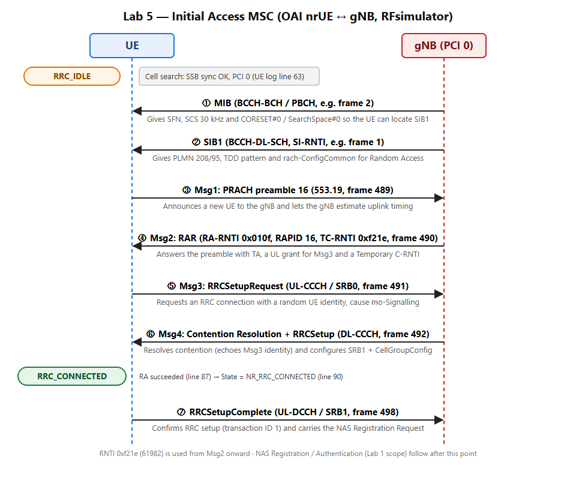

| # | Direction | Message | Channel / evidence | Purpose |
| ---: | --- | --- | --- | --- |
| — | UE (local) | Cell search, SSB sync | UE log lines 56–63, PCI 0 | Find the cell and lock to its time/frequency so the PBCH can be decoded. |
| 1 | gNB → UE | **MIB** | BCCH-BCH on PBCH, frame 2 | Gives SFN, SCS, and CORESET#0/SearchSpace#0 so the UE can find SIB1. |
| 2 | gNB → UE | **SIB1** | BCCH-DL-SCH, SI-RNTI, frame 1 | Gives cell access info (PLMN, TAC), TDD pattern, and `rach-ConfigCommon` for Random Access. |
| 3 | UE → gNB | **Msg1** PRACH preamble 16 | PRACH, 553.19, frame 489 | Tells the gNB a new UE wants access and lets it estimate UL timing. |
| 4 | gNB → UE | **Msg2** RAR | DL-SCH, RA-RNTI 0x010f, frame 490 | Answers RAPID 16 with TA, Msg3 UL grant, and TC-RNTI 0xf21e. |
| 5 | UE → gNB | **Msg3** RRCSetupRequest | UL-CCCH (SRB0), frame 491 | Requests an RRC connection with a random UE identity (`mo-Signalling`). |
| 6 | gNB → UE | **Msg4** Contention Resolution + RRCSetup | DL-CCCH (SRB0), frame 492 | Resolves contention and configures SRB1 and the cell group. |
| 7 | UE → gNB | **RRCSetupComplete** | UL-DCCH (SRB1), frame 498 | Confirms RRC setup (transaction ID 1) and carries the NAS Registration Request. |

The UE is in **RRC_IDLE** from cell search until Msg4. It moves to **RRC_CONNECTED** after it receives Msg4 with a matching Contention Resolution Identity and applies `RRCSetup` (UE log lines 87–90). It then sends `RRCSetupComplete` from the connected state.

Mermaid source for the same diagram:

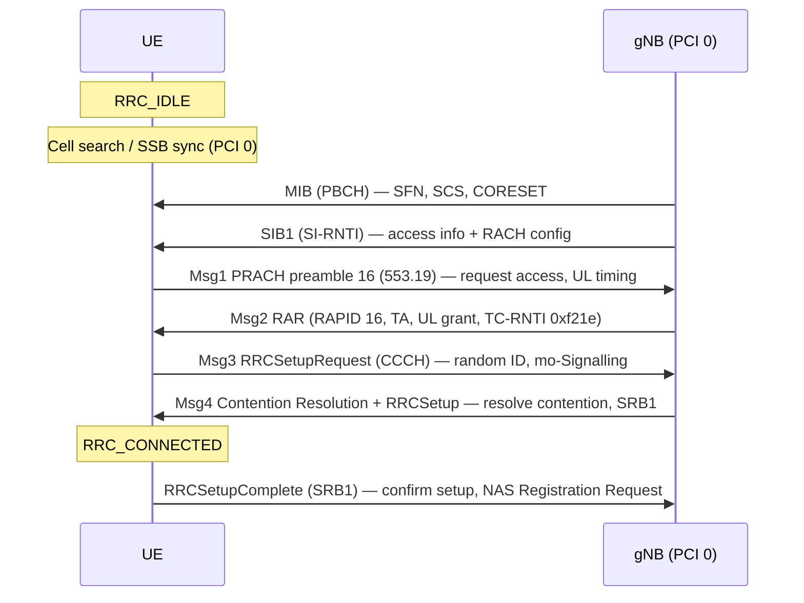
